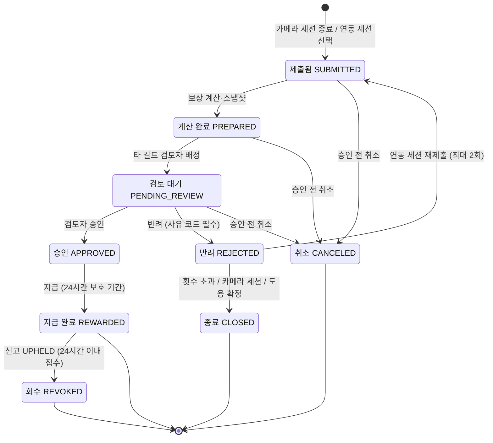

# 3. 규칙, 상태 전이, LLM이 들어갈 자리

> 목표: 클라이언트가 "이 경우엔요?"라고 물을 지점을 우리가 먼저 찾는다. 세부 주제의 필수 조건 두 가지(상태 전이, LLM)가 이 도메인의 어디에 들어갈 수 있는지 찾는다.

## 3-1. 규칙 (최소 5개)

> 규칙은 '항상 / 절대 / ~이면 ~한다' 형태로 씁니다. 예외는 '그런데 만약 ~라면?'으로 찾습니다.
> 예: "배송중이 된 주문은 셀러가 취소할 수 없다" → 만약 고객이 배송중에 취소를 요청하면?

| 번호 | 규칙 | 예외·경계 사례 (만약 ~라면?) | 어기면 생기는 문제 | 태그 | 출처 (카드 번호) |
| --- | --- | --- | --- | --- | --- |
| R1 | 운동별 일일 상한(예: 스쿼트·푸시업 각 300회, 플랭크 30분, 러닝 15km)을 넘은 운동량은 기록만 남기고 보상·타격·능력치는 0으로 한다. 기준은 운동 시작 시각의 날짜(KST)다 | 23:40~00:20처럼 자정을 넘긴 운동은 어느 날짜 상한에서 차감하나? (시작 시각의 날짜) 상한 직전에 낸 건이 반려됐다가 재제출되면 예약해 둔 상한은 유지되나? (유지) | 한 번에 몰아서 운동량을 부풀려 보상을 독식. 무리한 운동을 부추겨 부상 위험이 커짐 | #보상 #상한 [가정] | 기획서 v4 11장, 5-sonbumsu-1 (초보 러너 33% 부상 경험 → 과도한 운동량 제한의 근거 [추정]) |
| R2 | 제출 1건에는 운동 1종류만 담는다. 카메라 세션에서 여러 운동을 하면 인식된 운동 종류별로 나뉘어 각각 제출건이 된다 | 스쿼트·푸시업을 번갈아 한 서킷 운동은? (구간별로 나뉘어 2건) 인식이 애매한 동작은? (사용자가 카탈로그에서 선택) | 한 건에 여러 운동이 섞이면 부위·스킬·타격 단위를 하나로 정할 수 없어 보상·능력치·리플레이를 계산할 수 없음 | #제출 #카탈로그 | 기획서 v4 3장·6장 |
| R3 | 같은 사용자의 활성 제출건 중 같은 운동 종류와 시간대가 겹치면 접수를 거부한다. 다른 운동 종류가 겹치면 접수하되 이상치로 표시한다 | 이전 건이 `CANCELED`·`CLOSED`면 같은 시간대로 다시 낼 수 있나? (활성 건만 막으므로 가능) 카메라 스쿼트와 연동 러닝의 시간대가 겹치면? (동시에 할 수 없으므로 이상치 표시 후 검토자 판단) | 같은 운동을 여러 번 제출해 이중 보상 | #제출 #중복 | 기획서 v4 9장 |
| R4 | 검토는 다른 길드의 무작위 검토자만 하고, 본인·같은 길드 건은 배정하지 않는다 | 배정 후 승인 전에 검토자가 제출자의 길드로 옮기면? (승인 시점에 다시 검사해 막음) 검토자가 부족한 서비스 초기에는? (24시간 뒤 운영자 검토함) | 지인끼리 봐주기로 부정 보상, 2-2 As-Is의 봐주기 문제가 그대로 남음 | #검토 #권한 | 기획서 v4 10장, 2-2 As-Is 5단계 |
| R5 | 운동 종류와 횟수는 자세 추정 모델과 카탈로그의 인정 기준이 정하고, 보상 수치는 규칙 엔진이 계산한다. LLM 출력은 수치·운동 종류·상태에 절대 영향을 주지 않는다 | AI가 "렙 간격이 거의 같음: 영상 재생 의심"이라고 플래그를 달면 자동 반려하나? (안 함. 검토자가 스켈레톤 리플레이를 보고 판단) 제출 뒤 운영자가 카탈로그를 고치면? (`PREPARED` 스냅샷의 카탈로그 버전으로 계산) | AI 오판으로 억울한 반려나 잘못된 보상이 생기고, 같은 기록인데 계산할 때마다 결과가 달라짐 | #LLM #보상 | 기획서 v4 3장·18장 |
| R6 | 반려하면 사유 코드(`기록이상` / `본인확인실패` / `도용의심`)와 설명을 반드시 남기고, 재제출은 최대 2회까지 받는다 | 세 번째 반려를 받으면? (`CLOSED`) 카메라 세션이 반려되면 같은 데이터로 재제출할 수 있나? (불가. 같은 좌표는 같은 결과이므로 새 세션으로 다시 운동) 도용이 확정되면? (즉시 `CLOSED`) | 사유 없는 반려는 2-4 챌린저스처럼 "판정 기준이 애매하다"는 불만으로 이어짐 | #검토 #반려 | 기획서 v4 9장, 2-4 챌린저스 |
| R7 | 능력치의 위력·방어 계산에는 보호 기간(24시간)이 끝난 운동량만 반영한다 | 보호 기간 중에 신고가 들어와 처리가 길어지면? (처리가 끝날 때까지 '확정 대기' 유지) | 나중에 회수될 기록이 다음 제출건의 피해량을 부풀려 연쇄 회수가 생김 | #능력치 #회수 | 기획서 v4 4장·14장 |
| R8 | 회수는 지급 내역(RewardLedger)을 그대로 반대로 적용하고, 같은 보상은 한 번만 회수한다 | 그 피해로 보스가 이미 `DEFEATED`면? (보스는 부활하지 않고 개인 기여·길드 랭킹에서만 차감) 그 제출건으로 처음 얻은 스킬인데 같은 운동의 다른 유효 기록이 있으면? (스킬 유지) 경험치 차감으로 레벨이 내려가면? (레벨도 내림) 이미 소모한 체력은? (돌려주지 않음) | 회수할 때마다 결과가 달라지거나 이중 차감되어 레벨·아이템·능력치·스킬이 어긋남. 한 명의 부정으로 길드 전체가 벌을 받음 | #회수 #레이드 | 기획서 v4 15장·16장, 2-2 As-Is 5단계 |
| R9 | 타격 수 = 인정 운동량 ÷ 타격 단위(소수점 버림)이고, 인정량이 0보다 크면 최소 1타, 0이면 0타다. 총 피해량을 먼저 정한 뒤 타격 수로 나눈다 | 러닝 0.05km처럼 타격 단위보다 적으면? (1타) 일일 상한을 넘어 인정량이 0이면 리플레이를 보여 주나? (리플레이 없이 "일일 상한 초과" 카드만 표시) 플랭크 15초는? (15 ÷ 10 = 1.5 → 1타) | 리플레이 콤보 수가 실제 인정 렙과 달라 "내가 한 운동이 그대로 공격이 된다"는 핵심 약속이 깨짐 | #리플레이 #보상 | 기획서 v4 11장·12장 |
| R10 | 전투 서사에는 숫자, 다른 스킬명, 아이템명이 들어가면 안 된다. 2회 거부되면 기본 문구를 쓴다 | "30연타"처럼 숫자가 자연스럽게 들어가는 문장은? (거부. 숫자는 결과 카드에만) 스킬명에 숫자가 들어간 확장 스킬이 생기면? (카탈로그 규칙으로 스킬명에 숫자 금지) | 서사와 결과 카드의 숫자가 달라 혼란. 받지 않은 아이템을 받은 것처럼 보임 | #LLM #서사 | 기획서 v4 18장 |
| R11 | 카메라 영상은 절대 저장하거나 기기 밖으로 보내지 않는다. 서버에는 얼굴 랜드마크를 뺀 관절 좌표와 렙 타임스탬프만 보낸다 | 인식이 틀렸다며 사용자가 영상을 보내 확인해 달라고 하면? (받지 않음. 좌표와 새 세션으로 처리) 검토자가 관절 선만으로 판단하기 어려우면? (반려하지 않고 운영자 검토로 넘김) | 신체가 찍힌 영상이 유출되면 피해가 크고, 민감정보 처리 문제가 생김 | #개인정보 #카메라 | 기획서 v4 3장·19장 |
| R12 | 가동범위 기준을 넘은 렙만 인정하고, 사용자는 측정된 횟수를 줄일 수만 있고 늘릴 수 없다 | 부상 등으로 깊게 앉지 못하는 사용자는? (MVP는 같은 기준 적용, 접근성 기준은 팀 결정 필요) 카메라 각도 때문에 정상 렙이 미인정되면? (촬영 위치 안내 후 새 세션) | 반쪽 동작으로 횟수를 부풀리거나, 반대로 정상 동작이 억울하게 미인정됨 | #카메라 #인정기준 [가정] | 기획서 v4 3장, 1-2 폼·가동범위 |
| R13 | 건강 앱에 수동으로 입력된 기록과 속도 상한을 넘는 이동은 러닝 기록으로 인정하지 않는다 | 트레드밀에서 워치로 자동 기록한 러닝은? (자동 기록이므로 인정) 폰 없이 워치만 차고 뛴 경우는? (워치 기록이 건강 앱에 자동 동기화되면 인정) | 직접 입력한 거리나 차량 이동이 러닝으로 둔갑해 부정 보상 | #연동 #부정방지 | 기획서 v4 3장, 2-4 포켓몬 GO |
| R14 | 체력이 부족하면 던전 도전만 막고, 운동 제출·능력치 성장·레이드 공격은 항상 정상 반영한다 | 걸음 수 동기화가 늦어 회복이 안 되면? (동기화되는 대로 걸은 날짜 기준으로 반영) 체력이 0인 상태에서 운동하면? (제출 가능, 던전 대상만 고를 수 없음) | 운동했는데 아무것도 얻지 못하면 헛수고처럼 느껴져 이탈 | #체력 #던전 | 기획서 v4 5장·13장, 1-rhtnddd-1 |
| R15 | 걸음 수로 회복하는 체력은 하루 10,000보까지만 반영하고, 최대 체력을 넘는 회복은 이월하지 않는다 | 자정 직후 동기화된 전날 걸음은? (걸은 날짜에 반영) 걸음 수를 흔들어 늘리는 기기를 쓰면? (회복 상한이 있고 보상·공격력과 무관해 이득이 작음) | 걸음 조작으로 체력을 무한히 회복해 던전 도전 제한이 의미 없어짐 | #체력 #상한 | 기획서 v4 5장 |
| R16 | 14세 미만은 가입할 수 없다 | 생년월일을 거짓으로 입력하면? 가입 후 14세 미만으로 확인되면 계정과 기록은? | 법정대리인 동의 없이 아동의 개인정보·건강 데이터를 처리하게 됨 | #법령 #가입 [가정] | 기획서 v4 19장 (3-5에서 확인 예정) |
| R17 | 건강 앱 데이터는 사용자가 허용한 종류(걸음 수, 러닝 세션)만 가져오고, 심박수·GPS 경로는 가져오지 않는다 | 사용자가 중간에 권한을 해제하면? (이후 동기화 중단, 이미 반영된 체력·기록은 유지) 걸음 수가 건강 민감정보에 해당하면? (별도 동의 화면 추가) | 동의 범위를 넘는 건강·위치 정보 수집 | #법령 #연동 [가정] | 기획서 v4 3장·19장, 2-3 (3-5에서 확인 예정) |

## 3-2. 핵심 대상과 상태 전이

> **필수 조건입니다.** 세부 주제에는 상태가 바뀌는 핵심 대상이 반드시 있어야 합니다. 핵심 대상 후보를 찾아 상태를 적습니다.
>
> 기준:
> - 상태가 **4개 이상**이고, 처음 상태에서 끝 상태까지 순서가 있습니다.
> - 정상 경로 말고 **취소·반려·되돌림·실패 경로가 1개 이상** 있습니다.
> - 전이마다 **누가 바꾸는지, 어떤 조건에서 바꾸는지** 적을 수 있습니다.
>
> 도메인별 예시 (그대로 쓰지 말고 조사한 내용으로 바꿉니다):
>
> | 도메인 | 핵심 대상 | 상태 흐름 예시 |
> | --- | --- | --- |
> | 오픈마켓 셀러 운영 백오피스 | 주문 | 결제완료 → 상품준비중 → 배송지시 → 배송중 → 배송완료 (취소요청 → 취소완료, 반품요청 → 반품완료) |
> | 러닝 자세·훈련 코칭 | 주간 훈련 계획 | 계획됨 → 진행중 → 기록 제출 → 피드백 완료 (기록 부족 → 재측정 요청) |
> | 다문화 가정 행정 절차 안내 | 절차 진행 건 | 준비중 → 서류 확인 → 제출 완료 → 처리 완료 (서류 부족 → 보완 요청 → 서류 확인) |

**핵심 대상 후보**: 운동 제출건 (WorkoutSubmission)

> 다른 후보: 신고(Report) `OPEN → UNDER_REVIEW → UPHELD / DISMISSED`는 상태가 4개지만 마지막이 갈림길로 끝나 반려·되돌림·실패 경로가 없고, 레이드 보스(RaidBoss) `ACTIVE → DEFEATED → ARCHIVED`는 상태가 3개라 기준에 못 미칩니다. 둘 다 제출건의 회수(`REVOKED`)를 일으키거나 결과를 받는 보조 대상으로 둡니다.

| 지금 상태 | 다음 상태 | 누가 바꾸나 | 조건 | 되돌릴 수 있나 | 태그 |
| --- | --- | --- | --- | --- | --- |
| (없음) | `SUBMITTED` | 신청자 (카메라 세션은 시스템이 자동 생성) | 카메라 세션 종료 시 인식된 운동 종류별로 자동 생성되거나, 연동된 러닝 세션을 운동 종료 후 48시간 안에 선택해 생성. 같은 운동 종류의 활성 제출건과 시간대가 겹치지 않음. 수동 입력·속도 상한 초과 기록은 제외. 일일 상한 인정량을 원자적으로 예약 | 승인 전에는 취소 가능 | #정상 #접수 |
| `SUBMITTED` | `PREPARED` | 규칙 엔진 + 시스템 | 보상·타격 수 계산, 확정 능력치·약점 배율·카탈로그 버전 스냅샷 고정, 드랍 1회 생성, LLM 자료 첨부(LLM 실패 시 기본 문구). 계산 실패 시 `SUBMITTED` 유지 후 재시도 | 승인 전에는 취소 가능 | #정상 #계산 |
| `PREPARED` | `PENDING_REVIEW` | 시스템 | 타 길드 검토자 무작위 배정. 12시간 미처리 시 재배정, 24시간 배정 실패 시 운영자 검토함. 검토자가 관절 선만으로 판단하기 어렵다고 넘긴 건도 운영자 검토함 | 승인 전에는 취소 가능 | #정상 #배정 |
| `PENDING_REVIEW` | `APPROVED` | 검토자 (또는 운영자) | 스켈레톤 리플레이 또는 연동 기록을 보고 사람이 실제로 한 운동이라고 판단. 본인 확인 통과. 승인 시점에 같은 길드 여부 재검사 | 아니오 (이후 신고로만 회수) | #정상 #승인 |
| `APPROVED` | `REWARDED` | 시스템 (트랜잭션) | 경험치·아이템·능력치 경험치·레이드 피해량 지급, 24시간 보호 기간 시작. 지급 실패 시 `APPROVED` 유지 후 지급만 재시도, 반복 요청은 기존 결과 반환(멱등) | 신고 `UPHELD` 시 `REVOKED` | #정상 #지급 |
| `PENDING_REVIEW` | `REJECTED` | 검토자 | 사유 코드(`기록이상` / `본인확인실패` / `도용의심`)와 설명 필수. AI 플래그만으로는 반려 불가 | 연동 세션만 재제출로 `SUBMITTED` | #반려 |
| `REJECTED` | `SUBMITTED` | 신청자 | 연동 세션만 해당. 재제출 최대 2회, 새 버전 생성, 이전 기록·사유 보존, 드랍·상한 예약 유지. 카메라 세션은 같은 좌표로 같은 결과가 나오므로 재제출 불가(새 세션으로 다시 운동) | — | #반려 #재제출 |
| `REJECTED` | `CLOSED` | 시스템 / 운영자 | 재제출 횟수 초과, 카메라 세션 반려, 또는 운영자의 도용 확정. 상한 예약 해제 | 아니오 (종료) | #종료 #도용 |
| `SUBMITTED` / `PREPARED` / `PENDING_REVIEW` | `CANCELED` | 신청자 | 승인 전 취소. 상한 예약 해제. 취소와 승인이 동시에 오면 조건부 업데이트로 먼저 성공한 한 건만 인정 | 아니오 (종료) | #취소 |
| `REWARDED` | `REVOKED` | 시스템 (운영자 확정 후) | 보호 기간(24시간) 안에 접수된 신고가 `UPHELD`. 지급 내역을 그대로 반대로 적용(능력치 경험치 포함, 소모한 체력은 제외) | 아니오 (종료) | #회수 |

> 허용하지 않는 전이: 검토를 건너뛰는 모든 전이(`PENDING_REVIEW → REWARDED` 포함), `CLOSED` / `CANCELED` / `REVOKED`에서 나가는 전이, 신고 기한(보호 기간)이 지난 뒤 들어온 신고에 의한 `REVOKED`, 카메라 세션의 `REJECTED → SUBMITTED`.

> 표를 다 채우면 아래처럼 그림으로도 그립니다. GitHub는 `mermaid` 코드 블록을 그림으로 보여 줍니다. 예시의 상태 이름과 화살표를 우리 내용으로 바꿉니다. 미리 보기는 GitHub의 파일 화면이나 편집 화면의 **Preview** 탭에서 확인합니다.

## 3-3. 시간에 따라 달라지는 규칙

> 기한, 마감, 주말·공휴일, 유효기간처럼 시간이 끼는 규칙을 1개 이상 적습니다. 3-2의 상태 전이와 이어지면 더 좋습니다.
> 예: 결제 후 ○영업일 안에 배송지시가 없으면 지연으로 표시한다 / 체류 기간 만료 ○일 전부터 연장 신청을 할 수 있다

| 규칙 | 기준 시간 | 주말·공휴일이면? | 태그 | 출처 (카드 번호) |
| --- | --- | --- | --- | --- |
| 연동 러닝 세션은 운동 종료 후 48시간 안에 제출해야 접수된다. 카메라 세션은 세션이 끝나는 즉시 제출된다 (`SUBMITTED` 진입 조건) | 운동 종료 시각부터 48시간 (달력 시간) | 영향 없음. 사용자가 직접 내는 것이라 주말에도 똑같이 센다 | #접수 #기한 | 기획서 v4 9장 |
| 배정 후 12시간 동안 검토하지 않으면 다른 검토자에게 재배정하고, 24시간 안에 배정에 실패하면 운영자 검토함으로 넘긴다 | 배정 시각부터 12시간 / 최초 배정 시도부터 24시간 | 검토자는 사용자라 주말에도 돌아가지만, 운영자 검토함은 주말·공휴일에 처리가 멈출 수 있음 → 운영자 처리 기한을 둘지 결정 필요 [가정] | #검토 #재배정 | 기획서 v4 10장 |
| `REWARDED` 후 24시간은 보호 기간이다. 이 동안 신고를 받고, 획득 아이템은 `LOCKED`, 능력치 경험치는 '확정 대기'로 둔다. 기간 안에 신고가 있으면 처리가 끝날 때까지 잠금을 유지한다 | 지급 완료 시각부터 24시간 | 신고 접수는 영향 없음. 신고 처리(운영자 확정)가 주말에 늦어지면 잠금이 길어짐 | #보호기간 #신고 #회수 | 기획서 v4 4장·14장·17장 |
| 일일 상한은 운동 시작 시각의 날짜로 센다. 자정을 넘긴 운동은 시작한 날짜의 상한에서 차감한다 | KST 00:00~23:59 | 영향 없음 | #상한 | 기획서 v4 11장, 3-1 R1 |
| 체력은 걷지 않아도 시간당 일정량(예: 5)씩 자연 회복된다 | 마지막 회복 시각부터 1시간마다 | 영향 없음 | #체력 #회복 | 기획서 v4 5장 |
| 걸음 수로 회복하는 체력은 걸은 날짜 기준으로 하루 10,000보까지만 반영한다. 동기화가 늦어도 2일 전 걸음까지는 반영한다 | KST 날짜 / 동기화 허용 범위 2일 [가정] | 영향 없음 | #체력 #걸음 | 기획서 v4 5장, 3-1 R15 |
| 레이드는 주 단위로 돌아간다. 참여 마감(해당 주 운동분 접수 종료) 뒤 검토·보호 기간·신고 처리가 모두 끝나면 결과를 `ARCHIVED`로 확정하고, 보스 약점 부위는 매주 바뀐다 | 주 시작·마감 요일과 시각은 미정 (예: 월요일 00:00 KST) | 운영자 처리가 늦어지면 결과 확정도 늦어짐 → 확정 최대 기한 결정 필요 | #레이드 #주간 | 기획서 v4 16장 |
| 신고는 1인당 하루 3건까지이고, 기각 3회가 쌓이면 7일 동안 신고 권한을 정지한다 | 하루 = KST 날짜, 정지 = 3번째 기각 시각부터 7일 | 영향 없음 | #신고 #남용방지 | 기획서 v4 17장 |

## 3-4. LLM이 들어갈 자리

> **필수 조건입니다.** 세부 주제에는 LLM이 **서비스 기능 안에서** 쓰여야 합니다. 개발할 때 Claude를 쓰는 것은 여기에 해당하지 않습니다. 사용자가 서비스를 쓰는 동안 LLM이 무엇을 해 주는지 찾습니다.
>
> 좋은 자리를 고르는 기준:
> - 지금 사람이 **글을 읽고 쓰거나, 설명을 바꾸거나, 분류하는 데** 시간이 드는 곳 (2-2 As-Is의 문제 지점)
> - LLM이 틀려도 **사람이 확인하거나 규칙으로 걸러 낼 수 있는** 곳
> - 상태를 바꾸는 최종 결정은 **규칙이나 사람**이 하고, LLM은 초안·요약·분류·설명을 맡습니다
>
> 도메인별 예시:
>
> | 도메인 | LLM이 하는 일 | 사람이 확인하는 곳 |
> | --- | --- | --- |
> | 오픈마켓 셀러 운영 백오피스 | 고객 문의를 읽고 유형(취소·반품·배송 문의)을 분류하고 답변 초안 작성 | CS 담당이 고쳐서 보냄. 취소·반품 상태 변경은 규칙대로 |
> | 러닝 자세·훈련 코칭 | 러너가 남긴 훈련 기록과 느낌을 요약하고 다음 주 조정 제안 작성 | 코치가 승인해야 계획에 반영. 통증 언급은 의료 상담 권유로 |
> | 다문화 가정 행정 절차 안내 | 공식 안내문을 이용자의 언어와 쉬운 말로 바꾸고, 필요한 서류 목록을 뽑기 | 상담원이 원문과 비교해 확인. 법적 판단은 하지 않음 |

| 후보 | LLM에 넣는 것 (입력) | LLM이 내놓는 것 (출력) | 누가 보고 확인하나 | 틀리면 생기는 일 | 이어지는 상태 전이 | LLM에 보내면 안 되는 정보 (2-3 개인정보) |
| --- | --- | --- | --- | --- | --- | --- |
| L1 기록 요약 | 운동 종류·부위·기록 방식(카메라/연동), 인정·미인정 렙 또는 거리·시간, 메모(개인정보 가린 뒤) | `ai_summary`: 검토자가 한눈에 볼 한두 문장 (예: "스쿼트, 후반부에 미인정 렙이 늘어남. 메모에 무릎 통증 언급"). 메모에 통증·부상 언급이 있으면 표시 | 타 길드 검토자가 스켈레톤 리플레이·연동 기록과 함께 봄. 통증 언급이 표시되면 시스템이 제출자에게 정해진 휴식·전문가 상담 안내 문구를 보여 줌 | 요약이 기록과 다르면 검토자를 헷갈리게 함. 통증 언급을 놓치면 부상 위험을 알리지 못함. 실패하면 입력값으로 만든 기본 문장을 씀 | `PREPARED`에서 생성 → `PENDING_REVIEW` 검토 화면에 표시. 상태는 바꾸지 않음 | 닉네임·길드명, 메모 속 이름·연락처·장소, 관절 좌표 원본 |
| L2 이상치 설명 | L1 입력 + 규칙 검사 결과(상한 초과, 다른 운동 종류와 시간 겹침, 평소 기록과 큰 차이) + 렙 간격 통계, 좌표가 튀는 구간, 본인 확인 결과, 연동 기록 방식·페이스 | `ai_flags`: 의심 사유 문장 (예: "렙 간격이 처음부터 끝까지 거의 같음: 영상 재생 의심", "카메라 스쿼트와 러닝 기록의 시간대가 겹침"). 검토 화면 상단에 강조만 함 | 타 길드 검토자가 스켈레톤 리플레이를 보고 판단. 놓친 부정은 운영자 표본 재검토와 신고로 보완 | 오탐이면 검토자가 정상 건을 반려할 수 있고, 놓치면 부정 보상이 지급됨. 자동 반려는 하지 않음. 실패하면 규칙 검사 결과만 보여 줌 | `PENDING_REVIEW` → `APPROVED` / `REJECTED`는 검토자만 결정 | 관절 좌표 원본(통계로 바꿔서만 보냄), 사용자 식별 정보, 건강 앱 원본 데이터 |
| L3 전투 서사 | 카탈로그 스킬명, 운동 종류, 적·보스 이름, 약점 적중 여부 (수치는 넣지 않음) | `ai_story`: 2인칭, 스킬 동작 중심 한두 문장 (예: "마지막으로 일어서는 순간, 당신의 충격파가 골렘의 다리를 무너뜨렸다.") | 규칙 검사가 숫자·다른 스킬명·아이템명을 거르고(2회 실패 시 기본 문구), 사용자가 리플레이 뒤 결과 카드와 함께 봄 | 서사와 결과 카드가 어긋나 혼란, 받지 않은 아이템을 받은 것처럼 보임. 실패하면 스킬별 기본 문구 | `PREPARED`에서 생성, `REWARDED` 뒤 리플레이에서 표시. 상태는 바꾸지 않음 | 메모, 관절 좌표, 닉네임 (2인칭이라 이름이 필요 없음) |

> 공통 원칙: LLM 출력은 `ai_summary`, `ai_flags`, `ai_story` 필드에만 저장하고 보상·능력치·스킬·상태에 영향을 주지 않는다. 운동 종류와 횟수는 LLM이 아니라 기기 안의 자세 추정 모델과 카탈로그 인정 기준이 정한다. LLM 장애는 계산과 상태 진행을 막지 않는다 (R5).
>
> 결정 필요: 메모 속 이름·연락처·장소를 LLM에 보내기 전에 어떻게 가릴지 정해야 한다. 정해진 패턴(전화번호, 이메일 등)을 규칙으로 가리는 방법을 먼저 검토한다 [가정]. 통증 언급 시 보여 줄 안내 문구는 LLM이 쓰지 않고 미리 정해 둔 고정 문구를 쓴다.

## 3-5. 법령·통계·보고서로 확인하기

> 팀 합계 3개 이상. 3-1 규칙과 ⑤ 손해처럼 근거가 약한 내용을 자료로 확인합니다. 이 중 1개 이상은 `[추정]`·`[가정]`을 `[사실]`로 바꾸거나, 반대로 틀렸다는 것을 확인한 것이어야 합니다.
> 자료마다 [카드](cards/_template.md)를 한 장씩 만들고, 여기에는 목록만 적습니다. 조항 번호나 숫자는 카드에 자료에 적힌 그대로 옮깁니다.

| 자료 종류 | 카드 번호 | 자료명 (짧게) | 확인한 내용 요지 | 태그 변화 | 반영한 표 |
| --- | --- | --- | --- | --- | --- |
| 통계·보고서 | 5-sonbumsu-1 (재확인) | "초보 러너 33% 부상" 원출처 | 33%가 어떤 조사(대상·연도·표본 수)에서 나온 수치인지 원문으로 확인 | [추정] → (확인 후 기입) | 3-1 R1, 2-2 1단계 |
| 법령·보고서 | 2-[아이디]-01 | 개인정보 보호법 아동 조항 + 개인정보보호위원회 아동·청소년 가이드라인 | 14세 미만의 개인정보를 처리할 때 법정대리인 동의가 필요한지, 동의 방법은 무엇인지 | [가정] → (확인 후 기입) | 3-1 R16 |
| 법령·보고서 | 2-[아이디]-02 | 개인정보 보호법 민감정보 조항 + 개인정보보호위원회 해설 | 걸음 수·러닝 기록이 '건강' 민감정보에 해당해 별도 동의가 필요한지 | [가정] → (확인 후 기입) | 3-1 R17, 2-3 러닝 연동 세션·걸음 수 행 |
| 법령·보고서 | 2-[아이디]-03 | 개인정보 보호법 민감정보 중 생체인식정보 + 개인정보보호위원회 생체정보 가이드라인 | 얼굴을 뺀 관절 좌표가 생체인식정보 또는 개인정보에 해당하는지 | [추정] → (확인 후 기입) | 3-1 R11, 2-3 카메라 세션 행 |
| 업계 자료 | 3-[아이디]-01 | Android 개발자 문서 (Health Connect) | 기록마다 수동 입력과 자동 기록을 구분하는 정보가 있는지 | [가정] → (확인 후 기입) | 3-1 R13, 2-3 러닝 연동 세션 행 |
| 통계 | 5-[아이디]-01 | KOSIS 국민생활체육조사 | 규칙적 체육활동 참여율, 운동하지 않는 이유별 비율 | [추정] → (확인 후 기입) | 2-2 6단계, 제안서 제안 배경 |
