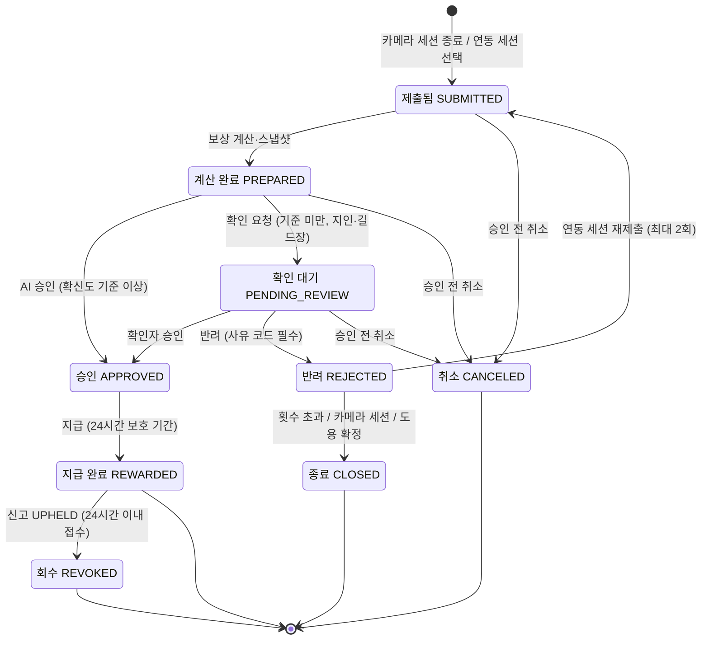

# 전운시(전지적 운동 시점) 프로젝트 제안서 — 초안

**한 줄 부제:** 맨몸 운동을 꾸준히 하려는 10~20대가 AI 판정을 바로 받은 운동 기록을 캐릭터 성장과 전투 리플레이로 이어갈 수 있게 하는 서비스 (출처: topic-selection 4-4, client-meeting-1 피드백 5·7·8, 질의응답 2·6)

> 이 파일은 Claude Code가 docs/ 조사 파일만 읽고 만든 초안입니다. 팀이 확인한 뒤 Word 양식으로 옮깁니다 (docs/proposal/README.md 2~3단계).
> 문장 끝 (출처: …)는 바탕이 된 조사 파일과 표 번호입니다. 양식으로 옮길 때 지웁니다.
> **기획서 v4 반영:** 01~05 조사 파일은 모두 v4 기준(카메라 자동 인식, 건강 앱 러닝 연동, 걸음 수 체력 회복)입니다.
> **1차 고객 미팅(2026-10-19) 반영:** docs/interview/client-meeting-1.md의 '질의응답'(이것이 바꾼 것)과 '받은 피드백과 처리'(바뀐 파일·절)에 적힌 제안서 범위(제안 요약, Ⅰ-3, Ⅳ-9~13, Ⅴ, Ⅶ-18)만 고쳤습니다. 나머지 절은 아직 v4 기준입니다. 출처의 질의응답·피드백 번호와 '여전히 가정' 행 번호는 미팅 기록의 표 번호입니다.

| 항목 | 내용 |
| --- | --- |
| 제안 팀 | 표백제 (출처: README) |
| 도메인 | 개인 운동·건강관리 지원 서비스 (출처: README) |
| 팀원 | 김지은, 성민규, 이시은, 손범수, 강준석 (출처: team/roles.md) |
| 팀 저장소 | https://github.com/AIServiceT2/HealthService_d |

---

## 제안 요약

| 항목 | 내용 |
| --- | --- |
| 서비스 한 줄 정의 | 맨몸 운동을 꾸준히 하려는 10~20대가 카메라 자세 인식으로 운동 중 즉시 피드백을 받고, AI가 바로 판정한 운동 기록을 캐릭터 성장과 전투 리플레이로 이어갈 수 있게 하는 서비스. 고른 운동을 폰 카메라가 한 개씩 세어 스킬과 타격 수로 바꾸고, 걸음 수는 캐릭터 체력을 회복시킨다. 러닝 연동은 후순위로 둔다 (출처: topic-selection 4-4, 02 2-4 차별점 1·3, 03 3-1 R9·R15, client-meeting-1 피드백 1·3·5·7, 질의응답 6) |
| 해결할 문제 | 맨몸 운동을 혼자 하거나 친구들과 인증 챌린지에 참여하는 10~20대는 운동을 기록·공유하는 상황에서 결과가 숫자와 달성 여부로만 남고 인증 판정도 늦거나 일관되지 않아, 성취감을 느끼며 운동을 지속하는 데 어려움을 겪는다. (출처: topic-selection 4-4, 02 2-2, client-meeting-1 피드백 5, 질의응답 6) |
| 핵심 기능 3가지 | ① 카메라 자세 인식·즉시 피드백과 운동 제출(운동 선택·튜토리얼, 취소·재제출 포함) ② AI 판정과 애매한 건의 지인·길드장 확인 ③ 전투 리플레이·결과 카드 (출처: mvp 5-2 F-02·F-04·F-06, 03 3-2, client-meeting-1 피드백 3·6·7·8) |
| 기대 효과 | 운동이 즉시 판정되어 성장·전투 결과로 연결되면 운동 지속과 성취감이 개선된다 [가정]. 고객이 답한 목표로 확인한다: 처음 제출한 사람이 4주 뒤에도 제출하는 비율 30~40% 이상, 사용자당 주 3건 이상 제출, 주간 레이드 참여율 50% 이상 (출처: topic-selection 4-4, Ⅴ, client-meeting-1 질의응답 1) |
| 고객께 요청드리는 것 | 4주 유지율 목표를 30%와 40% 중 무엇으로 할지, 운영자 인원, 애매한 건을 지인·길드장이 확인하는 방식이 괜찮은지, 푸시업·플랭크 등 나머지 운동의 일일 상한, 주간 플랜 기능이 필요하다고 보시는지 (출처: client-meeting-1 다음 미팅에서 물어볼 것, Ⅶ-18) |

---

## Ⅰ. 제안 개요

### 1. 제안 배경

**도메인 현황**

운동을 처음 시작하는 사람은 유튜브 루틴 영상·블로그로 운동량을 정하고, 러닝 앱·워치·메모로 기록하며, 단톡방·SNS·챌린지 앱에 캡처·인증샷을 올려 서로 확인한다. 같은 운동인데 앱마다 기록이 다르고 흩어지며, 맨몸 운동은 기록할 곳이 마땅치 않다. 친구 모임 챌린지는 방장이 구글 시트로 수작업 판정·집계한다. (출처: 02 2-2, topic-selection 4-4. 실제 사용자 확인 필요)
기존 서비스는 실제 동작을 공격으로 바꾸는 운동 게임(링 피트 어드벤처), 일상 걸음을 게임 자원으로 쓰는 위치 게임(포켓몬 GO), 참가비를 건 사진 인증(챌린저스)으로 나뉜다. 링 피트는 전용 기기가 필요하고 혼자 하는 구조이며, 챌린저스는 판정 기준이 애매하다는 불만이 있다. (출처: 02 2-4)

**근거**

| 번호 | 근거 (자료에 적힌 내용) | 태그 | 출처 |
| --- | --- | --- | --- |
| 1 | 게이미피케이션의 신체활동 효과 메타분석: RCT 16개·2,407명에서 신체활동 효과 Hedges g=0.42 (95% CI 0.14–0.69), 개입 종료 후 약 14주 뒤 추적 효과 g=0.15 (95% CI 0.07–0.23)로 줄어듦. 근거 수준 Low | [사실] (단, "우리 서비스가 지속률을 높인다"는 [가정]. 팀원의 원문 확인 필요) | [B2] 4-Kangjunseok09-01 (출처: 02 2-5, topic-selection 4-4) |
| 2 | 초보 러너 141명 중 63.1%가 기준 미달 저활동 상태. 프로그램 참가자 33.3%(21/63)가 부상 경험. 30분 연속 러닝 목표 달성률 74.6%(47/63), 성공 예측 요인은 연령·출석률·초기 자기효능감 | [사실] (03 3-5에서 원문 재확인 예정) | [B3] 5-sonbumsu-01 (출처: 02 2-5, 03 3-5) |
| 3 | 피트니스 앱 이용자의 훈련 빈도·세션 주기·이탈 패턴을 분석해 장기 운동 지속성과 유지율에 영향을 주는 요인을 식별함 | [사실] (서지정보 보완 필요) | [B1] 1-rhtnddd-01 (출처: 02 2-5, topic-selection 4-4) |

이 세 자료는 초보 운동인의 참여 장벽과 게임 요소의 가능성을 보여 주는 배경 자료다. 세 자료만으로 우리 대상자의 인증 분쟁이나 RPG의 지속 효과가 입증되지는 않는다. (출처: topic-selection 4-4 한계)
규칙의 근거가 될 법령·통계(14세 미만 동의, 건강 민감정보, 관절 좌표의 생체인식정보 해당 여부, Health Connect 수동 입력 구분, 국민생활체육조사)는 확인 예정이다. [조사 파일에 없음] (출처: 03 3-5)

### 2. 제안 목적

| 번호 | 목적 |
| --- | --- |
| 1 | 초보 운동인이 인증된 운동을 캐릭터 성장과 전투 결과로 이어 받아, 성취감을 느끼며 운동을 계속하게 한다. [가정] |
| 2 | 지인끼리의 봐주기 없이 다른 길드 검토자가 기록을 확인하고, 반려에는 사유를 남겨 인증 판정을 일관되게 한다. |
| 3 | 반복 요청·취소·LLM 실패가 있어도 보상이 정확히 한 번만, 규칙대로 반영되게 한다. |

(출처: topic-selection 4-4 문제 문장·해결되면 무엇이 달라지나·선정 이유, 03 3-1 R4·R6)

### 3. 제안 범위

| 항목 | 내용 |
| --- | --- |
| 대상 사용자 | **주 사용자:** 맨몸 운동을 꾸준히 하려는 10~20대. 고객사 설정 기준 3개월 안에 사용자 500명, 길드 약 50개, 하루 제출 300건 (출처: client-meeting-1 피드백 5, 질의응답 4·5·6). **보조 사용자:** AI가 애매하다고 판단한 건을 확인하는 지인·길드장, 같은 길드원(레이드 동료), 신고자, 운영자(AI 판정 문의·신고 처리) (출처: topic-selection 4-4, 02 2-1, client-meeting-1 피드백 8·9) |
| 이번에 하는 것 | 플레이어가 스쿼트를 고르고 튜토리얼을 본 뒤 목표 개수·세트를 정함 → 카메라 앞에서 스쿼트 30회를 하면 기기 안의 자세 인식 모델이 한 개씩 세며 인정 여부를 바로 보여 주고, 세션 종료 시 자동 제출 → 규칙 엔진이 보상·타격 수를 계산해 미리보기 "충격파 스톰프 ×30"을 보여 줌 → AI 판정 확신도가 기준 이상이라 바로 승인 → 경험치·아이템·능력치·던전 공략·보스 체력이 정확히 한 번 반영 → 캐릭터가 스쿼트 충격파로 30번 공격하는 리플레이와 결과 카드를 봄 (출처: mvp 5-1, 03 3-2, client-meeting-1 피드백 6·7·18) |
| 이번에 하지 않는 것과 이유 | **첫 데모에서 제외:** 나머지 스킬·약점 배율, 애매한 건의 지인·길드장 확인 경로, 반려·재제출·취소·신고·회수 예외 경로, 휴식 경고, 오각형 리포트, 숙련도 이펙트·보상 상자 연출·운동 중 모드 → 정상 경로 하나를 먼저 끝까지 돌리기 위해. **후순위:** 건강 앱 러닝 연동(러닝은 기존 앱이 많아 고객 우선순위가 낮음), 음성 인식(부가 기능) (출처: client-meeting-1 피드백 18, 질의응답 6). **MVP 전체에서 제외:** 확장 운동 4종, 스킬 연계 콤보, 검토용 3D 모델링, GPS 경로·심박 수집(건강 앱에서는 걸음 수·러닝 세션만), 웨어러블 직접 연동, 거래·강화·제작, 직업·길드 채팅, 여러 지역·막타 보너스, 자유 대화형 NPC, 고도화된 도용 탐지 → 5명·8주 안에서 게임 요소는 가볍게 두고 자세 인식 정확도에 시간을 쓰며, 동의 범위를 넘는 건강·위치 정보를 모으지 않기 위해 (출처: mvp 5-1, 03 3-1 R17, client-meeting-1 피드백 1·19). 최종 MVP에는 과제 필수 조건인 취소·반려·회수 경로를 포함하고(재제출은 건강 앱 러닝 연동과 함께 후순위이며, 반려된 카메라 세션은 새 세션으로 다시 운동한다), 나머지 운동·레이드·신고·회수·연출의 우선순위는 일정과 클라이언트 답변으로 조정한다 (출처: topic-selection 4-4 선정 이유와 범위) |

---

## Ⅱ. 현황 분석

### 4. 현재 방식과 문제점

**관련된 사람**

| 사용자 | 하는 일 | 지금 가장 큰 불편 |
| --- | --- | --- |
| 운동하는 플레이어 | 카메라 앞에서 근력 운동을 하면 운동 종류·횟수가 자동 인식되어 제출됨. 건강 앱을 연동해 러닝 기록을 제출하고, 걸음 수로 캐릭터 체력을 회복. 승인되면 전투 리플레이를 보고 장비를 장착 | 혼자 운동하면 지루하고 결과가 숫자로만 쌓여 몇 주 안에 그만둠. 기록이 앱마다 흩어지고, 맨몸 운동은 기록이 남지 않음 |
| 타 길드 검토자 | 무작위로 배정된 다른 길드의 제출건을 보고 사람이 실제로 한 운동인지 판단해 승인·반려, 반려 시 사유 코드와 설명을 남김 | 검토가 귀찮은 일이 되면 대충 승인하게 됨. 관절 선만 보고 진위를 판단하기 애매할 수 있음 |
| 길드장 | 길드를 만들고 길드원을 초대·관리하며, 주간 보스의 약점 부위에 맞춰 참여를 독려 | 단톡방 방장처럼 참여를 챙기는 일이 한 사람에게 몰림. 판정은 빠지지만 독려 부담은 남음 |
| 같은 길드원 (레이드 동료) | 보스 약점 부위에 맞춰 운동을 고르고 주간 보스에 피해를 줘 길드 공동 보상을 받음 | 한 명의 부정행위로 길드 전체 랭킹이 흔들릴까 걱정. 기여가 적은 사람에 대한 눈치 |
| 신고자 (같은 레이드 참여자) | 공개 요약 기록을 보고 의심스러운 보상을 지급 후 24시간 안에 신고 | 근거를 대기 어렵고, 기각되면 신고 권한이 정지될 수 있음 |
| 운영자 | 운동 카탈로그(인정 관절 각도, 일일 상한 등) 관리, 검토자 부족 시 직접 검토, 신고 최종 처리, 승인 건 표본 재검토 | 사용자가 늘면 검토와 신고가 몰려 처리 지연. 인정 기준이 너무 엄격하면 억울한 미인정, 너무 느슨하면 부정 |

(출처: 02 2-1)

**지금 일하는 순서 (As-Is)** — 운동을 시작한 초보 운동인이 기록·인증하다 그만두기까지

| 단계 | 누가 무엇을 하나 (쓰는 도구) | 막히는 곳 |
| --- | --- | --- |
| 1 | 운동을 처음 시작하려는 20대 직장인이 무엇을 얼마나 할지 정함 (유튜브 루틴 영상, 블로그, 메모 앱) | 자기 수준에 맞는 양을 몰라 처음부터 무리하다 다치거나, 막막해서 시작을 미룸 |
| 2 | 퇴근 후 혼자 러닝하거나 자취방에서 홈트를 함 (나이키 런 클럽, 런데이, 유튜브 홈트 영상) | 혼자라 지루해서 쉽게 건너뜀. 홈트는 횟수를 직접 세야 하고 자세를 봐 줄 사람이 없음 |
| 3 | 운동 기록을 남기고 확인함 (러닝 앱, 워치, 삼성헬스, 메모 앱) | 같은 운동인데 앱마다 거리·칼로리가 다르고 기록이 흩어짐. 맨몸 운동은 기록할 곳이 마땅치 않음 |
| 4 | 친구 인증 단톡방·챌린지 앱에 기록 캡처나 인증샷을 올림 (카카오톡 단톡방, 인스타그램, 챌린저스) | 사진 재사용·도용을 막을 수 없고 경로 지도로 집 위치가 노출됨. 챌린지 앱은 실패 판정 기준이 애매하다는 불만 |
| 5 | 친구 모임 챌린지 방장이 인증을 하나씩 체크하고 주말에 집계해 벌금을 걷음 (구글 시트, 엑셀, 토스·카카오페이) | 혼자 수작업이라 누락. 친한 사이라 봐주기. 부정이 드러나도 되돌릴 기준이 없음 |
| 6 | 시작한 지 3~4주 된 초보 운동러가 건너뛰는 날이 늘다가 그만둠 (러닝 앱 알림, 단톡방) | 기록이 숫자로만 쌓여 변화가 느껴지지 않고, 계속할 이유가 벌금 회피뿐이라 동기가 오래가지 않음 |

(출처: 02 2-2)

**이 문제로 생기는 손해**

- 인증의 신뢰성을 지인끼리 지키기 어렵다 (도용·재사용·봐주기). (출처: 02 2-2 핵심 문제)
- 판정·집계가 한 사람의 수작업에 의존한다. (출처: 02 2-2 핵심 문제)
- 잘못된 판정을 되돌리는 규칙이 없다. (출처: 02 2-2 핵심 문제)
- 운동 결과가 성장·서사로 이어지지 않아 지속성이 낮다. (출처: 02 2-2 핵심 문제)
- 초보 러너 프로그램 참가자의 33.3%(21/63)가 부상을 경험했다. [사실] [B3] 5-sonbumsu-01. 일일 운동량 상한의 배경으로 쓰지만, 상한은 보상 정책의 가정이며 의학적으로 안전한 운동량을 보장하는 기준이 아니다. (출처: 03 3-1 R1, topic-selection 4-4)
- 시간·돈의 손실 규모: [조사 파일에 없음]

### 5. 기존 서비스 분석

| 기존 서비스 | 잘하는 것 | 해결하지 못한 것 |
| --- | --- | --- |
| 링 피트 어드벤처 | 링 컨트롤러·다리 밴드 센서로 동작을 인식해 스쿼트·복근 운동 등 실제 동작이 공격 스킬이 됨. 스킬이 팔·배·다리·요가로 나뉘고 적마다 약한 계열이 있음. 운동 강도 설정과 휴식 권유 | 전용 기기와 거실 공간이 필요. 혼자 하는 구조라 몇 달 지나면 손이 잘 안 감. 후반에는 같은 동작 반복으로 지루함 |
| 포켓몬 GO | '어드벤처 싱크'로 건강 앱의 이동 거리를 가져와 보상에 반영. 일정 속도보다 빠른 이동은 거리로 인정하지 않음. 부정행위는 경고 → 일시 정지 → 영구 정지. 여럿이 함께 싸우는 레이드 | 걸은 거리가 늦게 반영되거나 누락된다는 불만. 배터리 소모. 위치 조작 치트가 계속 나옴 |
| 챌린저스 | 참가비를 건 사진 인증, 달성률에 따른 환급·상금. 인증 시간대·방식을 챌린지별로 정하고 부적절한 인증은 운영 검토로 실패 처리 | 인증 실패 판정 기준이 애매하고 이의 제기가 번거롭다는 불만. "운동 자체가 재밌지는 않다"는 반응 |

(출처: 02 2-4. 02 2-4는 "팀 사전 지식 기준 초안이며 최신 정책과 앱스토어 후기를 직접 확인해야 한다"고 적혀 있음 → 제안서에 쓰기 전 확인 필요)

**시사점**

- 가져갈 점: 운동 동작 = 공격, 부위별 약점이라는 재미 구조(링 피트), 일상 걸음을 게임 자원으로 바꾸는 구조와 속도 상한으로 차량 이동을 거르는 규칙(포켓몬 GO), 정해진 인증 규칙과 운영 검토(챌린저스) (출처: 02 2-4)
- 다르게 할 점: 전용 기기 대신 폰 카메라로 인식하고 러닝·걷기까지 연동, 혼자 하는 구조 대신 길드 협동 레이드, 운영자 한 곳에 몰리는 판정 대신 타 길드 교차 검토와 사유 코드 필수 반려, 위치 경로 없이 걸음 수 집계만 쓰고 걸음은 체력 회복에만 연결 (출처: 02 2-4)

---

## Ⅲ. 세부 주제 선정 과정

### 6. 검토한 문제 후보

| 후보 | 누구의 어떤 문제인가 (한 문장) | 근거 |
| --- | --- | --- |
| A — 운동 인증 기반 RPG | 혼자 러닝·홈트를 하거나 친구들과 인증에 참여하는 초보 운동인은 운동 기록이 숫자와 달성 여부로만 남고 인증의 신뢰성도 부족해, 운동을 계속할 동기와 공정한 성취감을 얻기 어렵다. | 02 2-2 4~6단계, 2-4 벤치마크, [B3] 5-sonbumsu-01, [B2] 4-Kangjunseok09-01. 인증 부정의 빈도와 RPG의 지속 효과는 별도 확인 필요 |
| B — 운동 인증 챌린지 운영 도구 | 친구 모임 챌린지 방장과 참가자는 인증 판정·주간 집계가 방장의 수작업에 의존하고 반려·정정 기준이 불명확해, 운영 부담과 참가자 간 분쟁을 겪는다. | 02 2-2 4~5단계, 2-4 챌린저스, 03 3-1 R3·R6, [B3] 5-sonbumsu-01. 방장의 작업시간·분쟁 규모는 추가 조사 필요 |
| C — 초보 운동인의 주간 계획·피드백 도구 | 혼자 운동하는 초보 운동인은 수준에 맞는 운동량과 점진적 목표를 정하기 어려워, 무리하거나 시작을 미루고 운동을 지속하지 못한다. | 02 2-2 1~2·6단계, 01 1-1, [B3] 5-sonbumsu-01, [B1] 1-rhtnddd-01. 개인별 적정 운동량 근거는 추가 조사 필요 |

(출처: topic-selection 4-1)

### 7. 선정 기준과 평가

먼저 필수 조건 두 가지(상태 전이, LLM)로 거르고, 통과한 후보만 7개 기준을 1~3점으로 매겼다. 점수는 `[가정]`인 평가 초안이며, ⑦ 팀의 흥미는 선호 조사 전이라 모두 2점으로 두었다.

| 후보 | 상태 전이 있음 | LLM 자리 있음 | 점수 합계 | 결정적이었던 기준 |
| --- | --- | --- | --- | --- |
| A | ○ (운동 제출건: `SUBMITTED → PREPARED → PENDING_REVIEW → APPROVED → REWARDED`, 반려·취소·재제출) | ○ (L1 요약·L2 이상치 설명을 검토자가 확인, L3 서사는 규칙 검사 후 표시) | 17 | ② 경계 사례 3점, ③ 상태·권한 3점. 중복 제출, 승인·취소 경합, 지급 재시도, 신고 후 회수를 검증할 수 있음 |
| B | ○ [가정] (인증건: 제출 → 기한 검사 → 방장 검토 → 승인 → 집계, 반려·보완·취소) | ○ [가정] (인증 요약·반려 안내 초안을 방장이 수정해 확정) | 16 | ⑥ LLM의 쓸모 1점. 짧은 인증 요약만으로 충분한 시간 절감이 있는지 불명확 |
| C | ○ [가정] (주간 계획: 제출 → 코치 검토 → 승인 → 진행 → 피드백 완료, 보완 요청·취소) | ○ [가정] (기록 요약·계획 초안을 코치가 검토·승인) | 15 | ⑤ 8주 MVP 가능성 1점. 개인별 적정 운동량 기준과 코치 확보가 미정 |

(출처: topic-selection 4-2, 4-3)

### 8. 최종 선정 이유

| 항목 | 내용 |
| --- | --- |
| 선정한 후보 | A — 운동 인증 기반 RPG, 서비스 이름 **전운시(전지적 운동 시점)** [가정: 팀 검토 후 확정] (출처: topic-selection 4-4) |
| 고른 이유 | A는 운동 지속이라는 문제에 인증의 신뢰와 게임의 성취를 함께 연결하면서, 규칙·권한·예외를 테스트할 대상이 구체적이다. 평가 초안에서 17점으로 가장 높고, 상태 전이·LLM 조건을 충족하며 기존 조사와 MVP 가설을 활용할 수 있다. 3주차 첫 데모는 스쿼트 1종의 제출 → 검토 → 지급 → 리플레이로 제한한다. |
| 고르지 않은 후보와 이유 | **B:** 구현은 쉽지만 운동을 계속할 동기라는 핵심 문제를 직접 다루기 어렵고 LLM의 필요성이 약하다. 인증 판정·집계의 장점은 A에 활용한다. **C:** 초보자의 참여 장벽을 다루지만 개인별 운동량 기준과 코치 검증 체계가 부족해 8주 MVP 위험이 크다. |
| 같은 도메인 팀과 겹침 조정 | 확인 전. 같은 도메인 다른 팀과의 주제 중복 확인을 보류 항목으로 등록했고, 팀 리더가 다른 팀·교사에게 확인 후 기록한다. 겹치면 대상 사용자·핵심 문제·서비스 범위를 조정하고 점수표를 재평가한다. |

다시 볼 조건: H1(지속 효과)·H2(교차 검토 참여)·H3(기록만으로 판단 가능한가)가 틀리거나, 3주차에 핵심 흐름·애니메이션 완성이 어렵거나, 다른 팀과 주제가 겹치면 범위·주제를 재검토한다. (출처: topic-selection 4-4, 4-5)

---

## Ⅳ. 제안 내용

### 9. 서비스 개요

| 항목 | 내용 |
| --- | --- |
| 서비스 이름 | 전운시(전지적 운동 시점) — 운동이 전투가 되는 인증형 RPG (출처: README, topic-selection 4-4) |
| 한 줄 정의 | 맨몸 운동을 꾸준히 하려는 10~20대가 AI 판정을 바로 받은 운동 기록을 캐릭터 성장과 전투 리플레이로 이어갈 수 있게 하는 서비스. 스쿼트로 하체가 강해지고, 걸은 만큼 회복한다 (출처: topic-selection 4-4, README, client-meeting-1 피드백 5·7·8, 질의응답 6) |
| 핵심 가치 | ① 운동하는 동안 바로 피드백을 받고, 실제로 한 운동이 그대로 전투 장면이 된다: 운동 종류 = 스킬, 인정 렙 = 타격 수 ② 누군가의 승인을 기다리지 않고 AI가 바로 판정해 성취감이 끊기지 않으며, 애매한 건만 사람이 확인한다 ③ 부위별 능력치가 오각형 리포트로 쌓이고, 길드 주간 레이드로 함께 계속할 이유가 생긴다 (출처: 02 2-4 차별점 1·2, 03 3-1 R9, client-meeting-1 피드백 3·7·8·12, 질의응답 1) |
| 차별점 | 1. 링 피트의 "운동 동작이 곧 공격"을 전용 기기 없이 폰 카메라로 제공. 자세 인식 모델은 여러 후보를 비교해 고르고 기기 안(온디바이스)에서 돌림 2. 운동 종류를 먼저 고르고 운동마다 판정 기준·튜토리얼·촬영 각도를 정해 두어 인식 정확도를 높임 3. AI가 모든 제출을 바로 판정하고, 애매한 건만 지인·길드장이 확인해 승인 대기와 운영자 판정 부담을 줄임 4. 얼굴은 보여 주지 않고 관절 선·실루엣만 쓰며, 카메라 영상과 위치 경로를 기기 밖으로 내보내지 않아 개인정보 노출 최소화 5. 부정이 드러나면 지급 내역을 역적용하고, 이미 쓴 아이템은 롤백하는 회수 규칙 6. LLM은 자세 교정 코멘트·성장 리포트·요약·서사에 쓰고 보상·판정에서 분리, LLM API를 쓸 수 없을 때도 대체 문구로 동작 (출처: 02 2-4 차별점 1~5, client-meeting-1 피드백 6·8·11·12·14·15·16·19) |

### 10. 목표 흐름 (To-Be)

| 순서 | 사용자가 하는 일 | 서비스가 해 주는 일 | As-Is와 달라진 점 |
| --- | --- | --- | --- |
| 1 | 플레이어가 운동 종류(스쿼트)를 고르고 튜토리얼을 본 뒤 목표 개수와 세트를 정함 | 운동별 판정 기준과 권장 촬영 각도를 안내 | 무엇을 얼마나 할지 막막하던 일이 운동별 안내와 목표 설정으로 바뀜 (As-Is 1단계) |
| 2 | 카메라 앞에서 스쿼트 30회를 함 | 기기 안의 자세 인식 모델이 한 개씩 세며 인정 여부를 바로 보여 줌. 쉬는 시간이 너무 길면 경고하고, 경고가 3회를 넘으면 공격 실패로 처리. 세션이 끝나면 자동 제출. 영상은 기기 밖으로 나가지 않음. 시간대 중복·일일 상한을 검사하고 접수 (`SUBMITTED`) | 횟수를 직접 세고 인증샷을 올리던 일이 자동 인식·즉시 피드백·접수로 바뀜. 맨몸 운동도 기록이 남고, 사진 재사용·도용이 어려워짐 (As-Is 2~4단계) |
| 3 | 보상 미리보기 "충격파 스톰프 ×30"을 확인 | 규칙 엔진이 보상·타격 수를 계산해 스냅샷 고정, AI 판정 확신도 첨부. LLM이 자세 교정 코멘트·전투 서사를 준비 (`PREPARED`) | 앱마다 흩어지던 기록이 같은 기준(스킬·타격 수)으로 환산됨 (As-Is 3단계) |
| 4 | (애매한 건만) 보낼 내용을 미리 보고 보내기 버튼으로 지인 또는 길드장에게 확인 요청 → 확인자가 관절 선·실루엣을 보고 승인 | 확신도가 기준 이상이면 바로 승인 (`APPROVED`). 기준 미만이면 사람 확인으로 넘김 (`PENDING_REVIEW` → `APPROVED`) | 방장이 하나씩 판정하던 일을 AI가 바로 하고, 애매한 건만 사람이 봄. 승인을 기다리지 않아 성취감이 바로 이어짐 (As-Is 5단계) |
| 5 | — | 경험치·아이템·능력치 경험치·레이드 피해량을 정확히 한 번 반영, 24시간 보호 기간 시작 (`REWARDED`) | 수작업 집계 대신 시스템이 정확히 한 번 반영 (As-Is 5단계) |
| 6 | 리플레이(30 COMBO)와 결과 카드, 오각형 성장 리포트를 보고, 평소 걸은 만큼 체력이 회복되면 던전에 도전 | 캐릭터가 스쿼트 충격파로 30번 공격하는 장면과 서사 표시. 부위별 능력치 변화를 오각형 그래프로 보여 줌. 걸음 수(하루 10,000보까지)로 체력 회복 | 숫자로만 쌓이던 기록이 성장·서사로 이어짐 (As-Is 6단계) |

AI 판정의 확신도 기준은 고객 답변(90%)을 쓰되 팀이 확정한다 (미팅 기록 질의응답 2, '여전히 가정' 2행). 경고 3회로 공격이 실패했을 때 운동 기록·능력치를 남길지는 팀 결정이 필요하다 ('여전히 가정' 6행). 건강 앱 러닝 연동은 후순위라 위 흐름에서 뺐다.

(출처: mvp 5-1, 03 3-1 R2·R3·R11·R13·R15, 3-2, 3-3, 02 2-2, client-meeting-1 피드백 6·7·8·9·12·18·19, 질의응답 2·6)

### 11. 주요 기능 목록

| ID | 기능명 | 설명 | 사용자 | 우선순위 | 관련 상태 / LLM |
| --- | --- | --- | --- | --- | --- |
| F-01 | 회원·캐릭터·길드 | 가입(14세 미만 불가), 나를 닮은 아바타 만들기, 길드 가입·길드장 관리 | 플레이어, 길드장 | 필수 | 상태 전이 없음 (확인 요청 대상인 길드장을 찾을 때 길드 정보 사용) |
| F-02 | 운동 제출·재제출·취소 | 고른 운동 종류로 카메라 세션 종료 시 자동 제출. 시간대 중복·일일 상한 검사. 건강 앱 러닝 세션 선택 제출(48시간 기한·수동 입력 검사)은 후순위. 재제출은 연동 세션만(러닝 연동이 후순위라 MVP에서는 재제출 없음) | 플레이어 | 필수 | → `SUBMITTED`, `REJECTED → SUBMITTED`, `→ CANCELED` |
| F-03 | 보상 계산·미리보기 | 경험치·총 피해량·타격 수·드랍·상한 계산, 확정 능력치·약점 배율·카탈로그 버전 스냅샷 고정, AI 판정 확신도 첨부, 미리보기 표시 | 시스템 | 필수 | `SUBMITTED → PREPARED` / LLM ○ (L1·L2·L3·L4 생성) |
| F-04 | AI 판정·확인 요청 | 확신도가 기준 이상이면 자동 승인. 기준 미만이면 사용자가 보낼 내용(관절 선 또는 실루엣, 운동 종류, 제출 간격 통계)을 미리 보고 지인·길드장에게 확인 요청 → 승인 또는 사유 코드와 함께 반려. 얼굴·나이·길드명은 보여 주지 않음. 운영자에게는 확인 요청이 아니라 AI 판정 문의로 보냄 | 플레이어, 지인·길드장, 운영자 | 필수 | `PREPARED → APPROVED`, `PREPARED → PENDING_REVIEW → APPROVED / REJECTED` / LLM ○ (L1·L2 표시) |
| F-05 | 멱등 지급과 던전·레이드 반영 | 보상을 정확히 한 번 지급, 24시간 보호 기간(아이템 `LOCKED`, 능력치 확정 대기) | 시스템 | 필수 | `APPROVED → REWARDED`, 보스 `ACTIVE → DEFEATED` |
| F-06 | 전투 리플레이·결과 카드 | 실제 인정 횟수만큼 공격하는 리플레이(최대 30초, 스킵 가능)와 결과 카드 | 플레이어 | 필수 | `REWARDED` 이후 / LLM ○ (L3 서사) |
| F-07 | 신고·회수 | 보호 기간 안 신고, 운영자 확정 후 지급 내역을 반대로 적용해 회수. 보스가 쓰러진 뒤 나온 아이템은 사용하지 않았으면 회수, 이미 사용했으면 롤백 | 신고자, 운영자 | 선택 | `REWARDED → REVOKED` |
| F-09 | 걸음 수 체력 회복 | 건강 앱의 걸음 수를 가져와 하루 10,000보까지 체력 회복. 체력이 부족하면 던전 도전만 막음 | 플레이어 | 선택 | 상태 전이 없음 |
| F-10 | 운동 선택·튜토리얼·목표 설정 | 운동 종류를 먼저 고르고, 운동별 튜토리얼과 판정 기준·권장 촬영 각도를 안내. 목표 개수와 세트를 정함 | 플레이어 | 필수 | 상태 전이 없음 |
| F-11 | 즉시 피드백·휴식 경고 | AI가 한 개씩 세며 인정 여부를 바로 보여 주고, 렙이 인정될 때마다 캐릭터가 한 번 공격(기존 F-08 운동 중 모드를 합침). 쉬는 시간이 너무 길면 경고, 경고 3회 초과 시 공격 실패 | 플레이어 | 필수 | 상태 전이 없음 (공격 실패 시 기록·능력치 처리는 미팅 기록 '여전히 가정' 6행) |
| F-12 | 오각형 성장 리포트 | 부위별 능력치를 오각형 그래프로 보여 주고 LLM이 성장 리포트를 붙임. 축 5개 중 1개는 팀 결정 필요(미팅 기록 '여전히 가정' 4행) | 플레이어 | 선택 [가정] | 상태 전이 없음 / LLM ○ (L5) |
| F-13 | 자세 교정 코멘트 | 저장한 자세 데이터로 다음 세션에서 고칠 점을 알려 줌. LLM API를 쓸 수 없으면 규칙 기반 기본 문구 | 플레이어 | 필수 | 상태 전이 없음 / LLM ○ (L4) |
| F-14 | 음성 인식 | 운동 중 화면 터치 대신 음성으로 조작하는 부가 기능 | 플레이어 | 후순위 | 상태 전이 없음 |

F-08 운동 중 모드는 F-11에 합쳤다.

(출처: mvp 5-2, 03 3-1 R13~R17, 3-2, 3-3, client-meeting-1 피드백 3·6·8·9·11·12·14·18·19, 질의응답 6)

### 12. 핵심 대상과 상태 흐름 (필수)

**핵심 대상:** 운동 제출건 (WorkoutSubmission)

**정상 경로:** `SUBMITTED` 제출됨 → `PREPARED` 계산 완료 → `APPROVED` 승인 (AI 판정) → `REWARDED` 지급 완료

**애매한 건의 사람 확인 경로:** `PREPARED` → `PENDING_REVIEW` 확인 대기 (지인·길드장) → `APPROVED` 승인 → `REWARDED`

**취소·반려·되돌림 경로:**
- `PENDING_REVIEW` → `REJECTED` 반려 → `SUBMITTED` (연동 세션만 재제출, 최대 2회) 또는 `CLOSED` (재제출 초과·카메라 세션 반려·도용 확정)
- `SUBMITTED` / `PREPARED` / `PENDING_REVIEW` → `CANCELED` (승인 전 취소)
- `REWARDED` → `REVOKED` (보호 기간 안 신고 `UPHELD`)

| 전이 (지금 → 다음) | 누가 바꾸나 | 조건 | 되돌릴 수 있나 | 태그 |
| --- | --- | --- | --- | --- |
| (없음) → `SUBMITTED` | 신청자 (카메라 세션은 시스템이 자동 생성) | 사용자가 고른 운동 종류로 카메라 세션 종료 시 자동 생성되거나, 연동된 러닝 세션을 운동 종료 후 48시간 안에 선택해 생성(후순위). 같은 운동 종류의 활성 제출건과 시간대가 겹치지 않음. 수동 입력·속도 상한 초과 기록은 제외. 일일 상한 인정량을 원자적으로 예약 | 승인 전에는 취소 가능 | #정상 #접수 |
| `SUBMITTED` → `PREPARED` | 규칙 엔진 + 시스템 | 보상·타격 수 계산, 확정 능력치·약점 배율·카탈로그 버전 스냅샷 고정, 드랍 1회 생성, AI 판정 확신도 첨부, LLM 자료 첨부(실패 시 기본 문구). 계산 실패 시 `SUBMITTED` 유지 후 재시도 | 승인 전에는 취소 가능 | #정상 #계산 |
| `PREPARED` → `APPROVED` | 시스템 (AI 판정) | 운동 종류별 판정 기준과 시작 시 무작위 동작 확인(실제 사람인지 확인하며 신원은 식별하지 않음)을 통과하고 확신도가 기준 이상(질의응답 2의 90%, 확정은 '여전히 가정' 2행) | 아니오 (이후 신고로만 회수) | #정상 #AI승인 |
| `PREPARED` → `PENDING_REVIEW` | 신청자 (보내기 버튼) | 확신도가 기준 미만. 보낼 내용(관절 선 또는 실루엣, 운동 종류, 제출 간격 통계)을 미리 보고 확인한 뒤 지인 또는 길드장을 골라 보냄. 얼굴·나이·길드명은 보내지 않음. 사용자가 아무에게도 보내지 않거나 확인자가 응답하지 않을 때의 처리는 팀 결정 필요 | 승인 전에는 취소 가능 | #애매 #확인요청 |
| `PENDING_REVIEW` → `APPROVED` | 확인자 (지인·길드장) | 관절 선 또는 실루엣을 보고 실제로 한 운동이라고 판단. 본인 건은 확인할 수 없음. 봐주기를 막기 위한 보상 제한·운영자 표본 재검토 여부는 팀 결정 필요(미팅 기록 '여전히 가정' 1행) | 아니오 (이후 신고로만 회수) | #사람확인 #승인 |
| `APPROVED` → `REWARDED` | 시스템 (트랜잭션) | 경험치·아이템·능력치 경험치·레이드 피해량 지급, 24시간 보호 기간 시작. 지급 실패 시 `APPROVED` 유지 후 지급만 재시도, 반복 요청은 기존 결과 반환(멱등) | 신고 `UPHELD` 시 `REVOKED` | #정상 #지급 |
| `PENDING_REVIEW` → `REJECTED` | 확인자 | 사유 코드(`기록이상` / `본인확인실패` / `도용의심`)와 설명 필수. AI 판정과 LLM 플래그만으로는 반려 불가 | 연동 세션만 재제출로 `SUBMITTED` | #반려 |
| `REJECTED` → `SUBMITTED` | 신청자 | 연동 세션만 해당. 재제출 최대 2회, 새 버전 생성, 이전 기록·사유 보존, 드랍·상한 예약 유지. 카메라 세션은 같은 좌표로 같은 결과가 나오므로 재제출 불가(새 세션으로 다시 운동) | — | #반려 #재제출 |
| `REJECTED` → `CLOSED` | 시스템 / 운영자 | 재제출 횟수 초과, 카메라 세션 반려, 또는 운영자의 도용 확정. 상한 예약 해제 | 아니오 (종료) | #종료 #도용 |
| `SUBMITTED` / `PREPARED` / `PENDING_REVIEW` → `CANCELED` | 신청자 | 승인 전 취소. 상한 예약 해제. 취소와 승인(AI 또는 확인자)이 동시에 오면 먼저 성공한 한 건만 인정 | 아니오 (종료) | #취소 |
| `REWARDED` → `REVOKED` | 시스템 (운영자 확정 후) | 보호 기간(24시간) 안에 접수된 신고가 `UPHELD`. 지급 내역을 그대로 반대로 적용(능력치 경험치 포함, 소모한 체력은 제외). 보스가 쓰러진 뒤 나온 아이템은 사용하지 않았으면 회수, 이미 사용했으면 롤백(롤백 범위는 미팅 기록 '여전히 가정' 5행) | 아니오 (종료) | #회수 |

허용하지 않는 전이: 판정을 건너뛰는 모든 전이(`SUBMITTED → APPROVED`, `PENDING_REVIEW → REWARDED` 포함), 확신도 기준 미만 건의 `PREPARED → APPROVED`, `CLOSED` / `CANCELED` / `REVOKED`에서 나가는 전이, 신고 기한(보호 기간)이 지난 뒤 들어온 신고에 의한 `REVOKED`, 카메라 세션의 `REJECTED → SUBMITTED`.
운영자에게 보내는 AI 판정 문의는 제출건의 상태를 바꾸지 않는다.

(출처: 03 3-2, client-meeting-1 피드백 6·7·8·9·11·19, 질의응답 2. 시작 시 무작위 동작 확인은 실제 사람인지만 보고 신원을 식별하지 않으므로 민감정보(생체인식정보)에 해당하지 않음. 03 3-2는 아직 타 길드 검토 기준이라 미팅 반영 후 함께 고쳐야 함)

### 13. LLM 활용 방안 (필수)

| 항목 | L1 기록 요약 | L2 이상치 설명 | L3 전투 서사 | L4 자세 교정 코멘트 | L5 성장 리포트 |
| --- | --- | --- | --- | --- | --- |
| LLM이 하는 일 | 애매한 건의 확인자가 한눈에 볼 한두 문장 요약. 메모에 통증·부상 언급이 있으면 표시 | 규칙 검사 결과와 렙 간격 통계 등을 바탕으로 AI가 애매하다고 본 이유를 문장으로 설명 | 리플레이 뒤 보여 줄 2인칭 한두 문장 서사 | 세션의 자세 데이터를 보고 다음 세션에서 고칠 점 한두 가지를 문장으로 알려 줌 | 한 주 동안의 능력치 변화와 운동 기록을 오각형 그래프 옆에 붙일 두세 문장으로 정리 |
| 관련 기능 | F-03, F-04 | F-03, F-04 | F-03, F-06 | F-03, F-13 | F-12 |
| 무엇을 읽나 (입력) | 운동 종류·부위·기록 방식(카메라/연동), 인정·미인정 렙 또는 거리·시간, 메모(개인정보 가린 뒤) | L1 입력 + AI 판정 확신도 + 규칙 검사 결과(상한 초과, 다른 운동 종류와 시간 겹침, 평소 기록과 큰 차이) + 렙 간격 통계, 좌표가 튀는 구간, 연동 기록 방식·페이스 | 카탈로그 스킬명, 운동 종류, 적·보스 이름, 약점 적중 여부 (수치는 넣지 않음) | 운동 종류와 판정 기준, 렙별 관절 각도 요약 통계, 미인정 사유 | 능력치 5개의 주간 변화, 운동 종류별 횟수, 레이드 참여 여부 |
| 무엇을 내놓나 (출력) | `ai_summary` (예: "스쿼트, 후반부에 미인정 렙이 늘어남. 메모에 무릎 통증 언급") | `ai_flags` (예: "렙 간격이 처음부터 끝까지 거의 같음: 영상 재생 의심"), 확인 화면 상단에 강조만 함 | `ai_story` (예: "마지막으로 일어서는 순간, 당신의 충격파가 골렘의 다리를 무너뜨렸다.") | `ai_form_tip` (예: "후반 10회는 덜 앉아서 인정되지 않았어요. 엉덩이를 조금 더 뒤로 빼 보세요.") [가정] | `ai_report` (예: "이번 주는 하체가 가장 많이 자랐어요. 코어 운동을 한 번 더 하면 오각형이 고르게 채워져요.") [가정] |
| 사람이 확인하는 곳 | 확인 요청을 받은 지인·길드장이 관절 선·실루엣과 함께 봄. 통증 언급이 표시되면 시스템이 미리 정해 둔 휴식·전문가 상담 안내 문구를 보여 줌 | 확인자가 관절 선·실루엣을 보고 판단. 놓친 부정은 신고로 보완 (운영자 표본 재검토는 미팅 기록 '여전히 가정' 1행) | 규칙 검사가 숫자·다른 스킬명·아이템명을 거르고(2회 실패 시 기본 문구), 사용자가 결과 카드와 함께 봄 | 사용자가 결과 화면에서 봄. 진단·처방처럼 들리는 표현은 규칙 검사로 거르고, 실패 시 운동별 기본 교정 문구 [가정] | 사용자가 오각형 그래프와 함께 봄. 수치는 그래프가 보여 주고, 문장 속 숫자가 그래프와 다르면 거부 [가정] |
| 상태 전이와의 관계 | `PREPARED`에서 생성, `PENDING_REVIEW` 화면에 표시. 상태는 바꾸지 않음 | `APPROVED` / `REJECTED`는 AI 판정 기준과 확인자가 결정. LLM 출력으로 자동 반려 없음 | `PREPARED`에서 생성, `REWARDED` 뒤 표시. 상태는 바꾸지 않음 | `PREPARED`에서 생성. 상태는 바꾸지 않음 | 제출건 상태와 무관 (주간 집계 뒤 생성) |
| LLM에 보내지 않을 정보 | 닉네임·길드명, 메모 속 이름·연락처·장소, 관절 좌표 원본 | 관절 좌표 원본(통계로 바꿔서만 보냄), 사용자 식별 정보, 건강 앱 원본 데이터 | 메모, 관절 좌표, 닉네임 | 관절 좌표 원본, 얼굴 정보, 닉네임·길드명 | 닉네임·길드명, 메모 |

공통 원칙: LLM 출력은 `ai_summary`, `ai_flags`, `ai_story`, `ai_form_tip`, `ai_report`에만 저장하고 보상·능력치·스킬·상태에 영향을 주지 않는다. 운동 종류와 횟수, 승인 여부는 LLM이 아니라 기기 안의 자세 인식 모델과 운동별 판정 기준이 정한다. LLM 장애는 계산과 상태 진행을 막지 않는다. (출처: 03 3-4, 3-1 R5, client-meeting-1 피드백 12·13·14)
LLM API를 쓸 수 없을 때(장애·호출 한도)는 규칙 기반 기본 문구를 보여 주고, 같은 입력의 이전 결과가 저장돼 있으면 다시 쓴다. LLM 입력은 서버에 저장한 자세 데이터·집계값으로 언제든 다시 만들 수 있으므로, 응답 도중 연결이 끊기면 같은 입력으로 다시 요청한다. 대체 방식의 구체안은 팀에서 정한다. [가정] (출처: client-meeting-1 피드백 14)
해외 LLM API를 쓰면 개인정보 처리방침에 국외 이전 사항을 공개한다. [가정] (출처: 1차 미팅 후 법령 조사. 03 3-5 카드 작성 시 확인)
카메라 영상은 기기 밖으로 나가지 않으므로 LLM에 보낼 이미지가 없고, 이상치 설명은 숫자 통계만으로 판단한다. 메모 속 개인정보는 전화번호·이메일 같은 정해진 패턴을 규칙으로 가리는 방법을 먼저 검토한다. [가정] (출처: 02 2-3, 03 3-4 결정 필요)

---

## Ⅴ. 기대 효과와 성공 지표

| 구분 | 무엇이 | 지금 | 목표 | 어떻게 확인하나 |
| --- | --- | --- | --- | --- |
| 정량 (사용 효과) | 처음 제출한 사람 중 4주 뒤에도 제출하는 비율 | 미측정 | 30~40% 이상 (30%와 40% 중 고객 재확인: 미팅 기록 '여전히 가정' 8행) | 제출 이력 로그를 저장하고 그래프로 확인 |
| 정량 (사용 효과) | 사용자당 주간 제출 건수 | 미측정 | 주 3건 이상 | 제출 이력 로그를 저장하고 그래프로 확인 |
| 정량 (사용 효과) | 주간 레이드 참여율 | 미측정 | 50% 이상 | 레이드 참여 기록을 그래프로 확인 |
| 정량 (기능 인수) | 확신도 기준 미만 건의 자동 승인 건수 | — | 0건 | AI 판정 확신도와 승인 경로 확인 |
| 정량 (기능 인수) | 반복 지급 요청 시 반영 건수 | — | 항상 1건만 반영 | 같은 지급 요청 반복 테스트 |
| 정량 (기능 인수) | 반려건의 사유 기록 비율 | — | 100% (반려건마다 사유 기록) | `REJECTED` 건의 사유 코드 확인 |
| 정량 (기능 인수) | 승인 전 취소건의 지급 건수 | — | 0건 | `CANCELED` 건의 지급 내역 확인 |
| 정성 | 성취감 | 미측정 | 개선 [가정] | 성취감 설문 |
| 정성 | LLM 실패 시에도 정상 흐름 완료 | — | 제출 → 지급 → 리플레이 완료, LLM 자리에는 기본 문구 표시 | 시연에서 확인 (LLM 실패·API 사용 불가 상황 포함) |

운동이 즉시 판정되어 성장·전투 결과로 연결되면 운동 지속과 성취감이 개선될 것이다 [가정]. 사용 효과 지표의 목표는 1차 미팅에서 고객이 답한 값이며, 4주 유지율은 30%와 40% 중 무엇으로 할지 다시 확인한다. (출처: topic-selection 4-4, 03 3-2·3-4, mvp 5-5 질문 1·8, client-meeting-1 질의응답 1, '여전히 가정' 8행)

---

## Ⅵ. 추진 계획

### 14. 일정

(초안에서 쓰지 않음 — 양식에 미리 채워진 일정에서 '우리 팀 목표' 칸만 3단계에서 고침)

### 15. 팀 구성과 역할

| 역할 | 이름 | 이 프로젝트에서 맡는 일 |
| --- | --- | --- |
| 팀 리더 (프로덕트 오너 겸) | 김지은 | 진행 관리(데일리 스크럼·회고), 고객 요구사항을 백로그로 정리하고 우선순위 제안, 인수 조건 작성, 고객 질문과 결정 기록 |
| 테크 리드 | 성민규 | 기술 방향·구조 결정, 리뷰 기준, 저장소·CI 관리, 병합 순서와 통합 관리 |
| 개발자 1 | 이시은 | 맡은 기능 구현, 테스트 작성 (맡을 기능 번호: [조사 파일에 없음]) |
| 개발자 2 | 손범수 | 맡은 기능 구현, 테스트 작성 (맡을 기능 번호: [조사 파일에 없음]) |
| 테스트 담당 | 강준석 | 인수 조건을 테스트 시나리오(정상·실패·경계값)로 바꾸기, 개발 전 실패하는 테스트, PR 테스트 리뷰, 회귀 확인. 기능 구현에도 참여 |

역할은 스프린트마다 교대한다. (출처: team/roles.md)

---

## Ⅶ. 전제 조건, 위험, 고객 확인 요청

### 16. 전제 조건과 가정

| 구분 | 내용 | 태그 | 출처·근거 |
| --- | --- | --- | --- |
| 규칙 | 운동별 일일 상한(예: 스쿼트·푸시업 각 300회, 플랭크 30분, 러닝 15km)을 넘은 운동량은 기록만 남기고 보상·타격·능력치는 0으로 한다. 기준은 운동 시작 시각의 날짜(KST) | [가정] | 03 3-1 R1, [B3] 5-sonbumsu-01 |
| 규칙 | 검토는 다른 길드의 무작위 검토자만 하고, 본인·같은 길드 건은 배정하지 않는다 | — | 03 3-1 R4 |
| 규칙 | 운동 종류와 횟수는 자세 추정 모델과 카탈로그 인정 기준이, 보상 수치는 규칙 엔진이 정한다. LLM 출력은 수치·운동 종류·상태에 절대 영향을 주지 않는다 | — | 03 3-1 R5 |
| 규칙 | 카메라 영상은 저장하거나 기기 밖으로 보내지 않는다. 서버에는 얼굴 랜드마크를 뺀 관절 좌표와 렙 타임스탬프만 보낸다 | — | 03 3-1 R11 |
| 규칙 | 건강 앱에 수동 입력된 기록과 속도 상한을 넘는 이동은 러닝으로 인정하지 않는다. 건강 앱에서는 사용자가 허용한 걸음 수·러닝 세션만 가져오고 심박수·GPS 경로는 가져오지 않는다 | [가정] (R17) | 03 3-1 R13·R17, 2-4 포켓몬 GO |
| 규칙 | 14세 미만은 가입할 수 없다 | [가정] (3-5 법령 확인 예정) | 03 3-1 R16 |
| 가정 | 가동범위 기준을 넘은 렙만 인정하고 사용자는 횟수를 줄일 수만 있다. 깊게 앉지 못하는 사용자를 위한 접근성 기준은 팀 결정 필요 | [가정] | 03 3-1 R12 |
| 가정 | H1 실제로 한 운동이 스킬·콤보가 되는 전투 리플레이가 사용자를 몇 주 이상 계속 운동하게 만든다 → 틀리면 길드 협동·목표 설정 같은 다른 동기 장치에 무게를 옮겨야 함 | [가정] | mvp 5-3 H1, [B2] 4-Kangjunseok09-01 |
| 가정 | H2 다른 길드 사용자가 배지 보상만으로도 남의 제출건을 제때, 성실하게 검토한다 → 틀리면 운영자 중심 검토나 검토 보상 재설계 | [가정] | mvp 5-3 H2 |
| 가정 | H3 폰 카메라의 자세 추정으로 근력 운동 횟수를 믿을 만하게 셀 수 있고, 검토자가 스켈레톤 리플레이(관절 선)와 연동 기록만으로 실제로 한 운동인지 판단할 수 있다 → 틀리면 촬영 위치 안내·인정 기준 조정, 운영자 검토 비중 확대 | [가정] | mvp 5-3 H3, 03 3-1 R11·R12 |

### 17. 위험 요소와 대응

| 위험 | 일어나면 생기는 일 | 대응 |
| --- | --- | --- |
| 스킬 애니메이션·연출 작업이 커서 8주 안에 끝내지 못한다 | 핵심 가치인 전투 리플레이가 시연 때 완성되지 않음. 다른 기능 일정까지 밀림 | 첫 데모는 스쿼트 1종만 완성하고 나머지는 이후로 미룸. 숙련도별 이펙트 단계를 줄이고 공용 이펙트 재사용. 3주차에 아트 진행 상황을 보고 스킬 수를 다시 정함 |
| 신체 정보(카메라 영상, 관절 좌표)나 건강·생활 패턴 정보가 LLM이나 다른 사람에게 노출된다 | 신체·건강 정보 유출, 민감정보 처리 문제, 사용자 신뢰 하락 | 영상은 기기 밖으로 보내지 않고 얼굴 랜드마크를 뺀 좌표만 서버로 보냄. LLM에는 구조화된 값과 통계만 보내고 좌표 원본은 보내지 않음. GPS 경로·심박은 가져오지 않음. 관절 좌표의 생체정보 해당 여부는 3-5에서 확인 예정 |
| 카메라 인정 기준(관절 각도)을 잘못 잡는다 | 너무 엄격하면 정상 렙이 억울하게 미인정되고, 너무 느슨하면 반쪽 동작으로 횟수를 부풀림 | 운영자가 카탈로그 버전으로 기준 관리, 제출건은 `PREPARED` 스냅샷의 카탈로그 버전으로 계산. 각도 문제로 미인정되면 촬영 위치 안내 후 새 세션 |
| LLM이 틀린 요약·이상치·서사를 낸다 | 오탐으로 정상 건이 반려되거나, 서사와 결과 카드의 숫자가 달라 혼란 | LLM 출력은 `ai_*` 필드에만 저장하고 자동 반려에 쓰지 않음. 서사에 숫자·다른 스킬명·아이템명이 있으면 거부하고 2회 실패 시 기본 문구. LLM 장애에도 상태 진행은 그대로 |

(출처: mvp 5-4, 03 3-1 R5·R11·R12·R17, 3-5)

### 18. 고객 확인·협조 요청

**미팅에서 꼭 여쭙고 싶은 것 3가지**

| 번호 | 질문 | 이 답으로 정할 것 |
| --- | --- | --- |
| 1 | 서비스를 연 지 3개월 뒤 "잘 되고 있다"고 판단하신다면, 어떤 숫자나 장면을 보고 그렇게 판단하시겠습니까? 예를 들어 한 달 뒤에도 운동을 제출하는 사람의 비율, 길드 레이드 참여율, 주당 운동 횟수 중 무엇을 가장 먼저 보시겠습니까? | Ⅴ 성공 지표, 첫 데모에서 강조할 흐름 (개인 성장 중심인지 길드 협동 중심인지) |
| 2 | 운동 인증이 진짜인지 확인하는 일을 누가 맡는 것이 이 서비스에 맞다고 보십니까? 생각하신 방식이 있다면 그 이유와, 그 사람이 볼 수 있어야 하는 것과 보면 안 되는 것도 함께 말씀해 주십시오. | 검토 주체(사용자 교차 검토 / 운영자 / 혼합), 검토 화면의 공개 범위, 검토자 배정 규칙 |
| 3 | 하루에 러닝 20km나 스쿼트 500회를 제출한 사용자가 있다면 서비스가 어떻게 다루기를 바라십니까? 하루 인정 운동량, 운동 후 제출 기한, 반려 뒤 재제출 횟수를 정할 때 가장 중요하게 보시는 기준은 무엇입니까? | 일일 상한·제출 기한·재제출 횟수 수치, 상한 초과분 처리 방식 |

(출처: mvp 5-5 질문 1~3)

**고객사 설정에서 정해 주셨으면 하는 것**

| 번호 | 정해 주셨으면 하는 것 | 정해지면 바뀌는 것 |
| --- | --- | --- |
| 1 | 예상 사용자 수·길드 수와 길드 규모 | 1차 미팅 답변: 3개월 안에 사용자 500명, 길드 약 50개 → Ⅰ-3 대상 사용자에 반영. 검토를 AI 판정과 지인·길드장 확인으로 바꿔 다른 길드 검토자 부족 문제는 없어짐 (Ⅳ-12) |
| 2 | 하루 운동 제출 건수와 운영자 인원 | 1차 미팅 답변: 하루 300건, 운영자 인원은 답변 없음 → 운영자는 판정하지 않고 AI 판정 문의·신고만 처리 (Ⅳ-11 F-04, Ⅳ-12). 운영자 인원은 다시 여쭘 |
| 3 | 주 사용자층 (운동 초보 / 기존 러너·운동인) | 1차 미팅 답변: 10~20대, 맨몸 운동 위주, 러닝은 기존 앱이 많아 우선순위 낮음 → 주 사용자를 맨몸 운동을 꾸준히 하려는 10~20대로 수정하고 건강 앱 러닝 연동은 후순위 (제안 요약, Ⅰ-3, Ⅳ-9, Ⅳ-11) |

**다음에 다시 여쭐 것:** 4주 유지율 목표를 30%와 40% 중 무엇으로 할지, 운영자 인원, 애매한 건을 지인·길드장이 확인하는 방식이 괜찮은지, 푸시업·플랭크 등 나머지 운동의 일일 상한, 주간 플랜 기능 필요 여부

(출처: mvp 5-7, client-meeting-1 질의응답 4·5·6, 피드백 5·8·9, 다음 미팅에서 물어볼 것)

---

## 부록

### A. 용어 정리

| 용어 | 뜻 | 헷갈리는 비슷한 말과 차이 |
| --- | --- | --- |
| 렙 | 한 동작을 1번 반복한 것 (스쿼트 1회 = 1렙) | 세트 (렙을 묶은 단위. "15렙 3세트" = 15회씩, 쉬었다가 3번) |
| 폼 | 운동 동작의 자세. "폼이 무너졌다" = 자세가 흐트러짐 | 가동범위 (동작을 얼마나 깊게 했는지. 스쿼트를 반만 앉는 건 가동범위 문제) |
| AI 자세 인식 | 카메라가 몸의 관절 위치를 찾아 어떤 동작인지, 몇 번 했는지 판단하는 기능 | 자세 교정 (틀린 자세를 알려 주고 고치게 하는 것. 인식은 판단까지, 교정은 피드백까지) |
| 맨몸운동 | 기구 없이 자기 체중으로 하는 운동 (스쿼트·푸시업·플랭크) | 웨이트 (덤벨·바벨 등 무게를 들고 하는 운동) |
| 페이스 | 1km 뛰는 데 걸리는 시간 (분/km) | 속도 (km/h, 숫자가 클수록 빠름. 페이스는 반대) |
| 만보 걷기 | 하루 10,000보를 목표로 걷는 것 | 이동 거리 (같은 걸음 수라도 보폭에 따라 거리가 다름) |
| 수동 입력 | 건강 앱에 사용자가 직접 운동 시간·거리를 적어 넣은 기록 | 자동 기록 (워치·앱이 측정해 저장한 기록. 수동 입력은 실제 측정이 아님) |
| 연동 | 다른 앱의 데이터를 가져오도록 권한·연결을 설정하는 것 | 동기화 (연결된 뒤 데이터를 최신 상태로 맞추는 동작) |
| 오운완 | '오늘 운동 완료'의 줄임말. SNS·단톡방에 운동을 인증할 때 쓰는 말 | 인증샷 (오운완을 증명하려고 올리는 사진·캡처 자체) |
| 오버트레이닝 | 회복보다 훈련이 많아 기록과 컨디션이 계속 떨어지는 상태 | 근육통 (DOMS, 며칠 지나면 회복되는 정상 반응) |

(출처: 01 1-2. 01 1-2의 출처 칸이 모두 "AI(검증 필요)"이므로 제안서에 쓰기 전 확인 필요)

### B. 참고 자료

- [B1] PMC, 2024, Analysis of Training Behavior in Users of a Fitness App, https://pmc.ncbi.nlm.nih.gov/articles/PMC12828317/ (카드 1-rhtnddd-01)
- [B2] Alexandre Mazeas, Martine Duclos, Bruno Pereira, Aïna Chalabaev, 2022, Evaluating the Effectiveness of Gamification on Physical Activity: Systematic Review and Meta-analysis of Randomized Controlled Trials, Journal of Medical Internet Research 24(1) e26779, https://doi.org/10.2196/26779 (카드 4-Kangjunseok09-01)
- [B3] Carolyn R. Plateau, Justine Anthony, Stacy A. Clemes, Clare D. Stevinson, 2022, Prospective study of beginner running groups: psychological predictors and outcomes of participation, https://www.tandfonline.com/doi/full/10.1080/08964289.2022.2100865 (카드 5-sonbumsu-01)
- 확인 예정 (03 3-5, 카드 미작성): 개인정보 보호법 아동·민감정보·생체인식정보 조항과 개인정보보호위원회 가이드라인, Android 개발자 문서(Health Connect), KOSIS 국민생활체육조사
