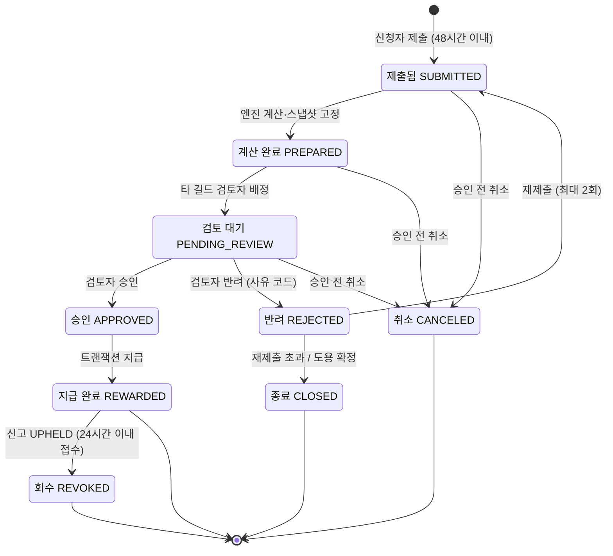

# 운동이 전투가 되는 인증형 RPG 프로젝트 제안서 — 초안

**한 줄 부제:** 초보 운동인이 검토받은 운동 기록을 캐릭터 성장과 전투 리플레이로 이어갈 수 있게 하는 서비스 (출처: topic-selection 4-4)

> 이 파일은 Claude Code가 docs/ 조사 파일만 읽고 만든 초안입니다. 팀이 확인한 뒤 Word 양식으로 옮깁니다 (docs/proposal/README.md 2~3단계).
> 문장 끝 (출처: …)는 바탕이 된 조사 파일과 표 번호입니다. 양식으로 옮길 때 지웁니다.

| 항목 | 내용 |
| --- | --- |
| 제안 팀 | [조사 파일에 없음] (README 팀명 칸이 비어 있음) |
| 도메인 | [조사 파일에 없음] (README 배정받은 큰 도메인 칸이 비어 있음) |
| 팀원 | 김지은, 성민규, 이시은, 손범수, 강준석 (출처: team/roles.md) |
| 팀 저장소 | https://github.com/AIServiceT2/HealthService_d |

---

## 제안 요약

| 항목 | 내용 |
| --- | --- |
| 서비스 한 줄 정의 | 초보 운동인이 검토받은 운동 기록을 캐릭터 성장과 전투 리플레이로 이어갈 수 있게 하는 서비스. 실제로 한 운동 종류가 스킬, 횟수·거리가 타격 수가 된다 (출처: topic-selection 4-4, 02 2-4 차별점 3) |
| 해결할 문제 | 혼자 운동하거나 친구들과 인증 챌린지에 참여하는 초보 운동인은 운동을 기록·공유하는 상황에서 결과가 숫자와 달성 여부로만 남고 인증 판정도 일관되지 않아, 성취감을 느끼며 운동을 지속하는 데 어려움을 겪는다. [추정] (출처: topic-selection 4-4, 02 2-2) |
| 핵심 기능 3가지 | F-02 운동 제출·재제출·취소 / F-04 타 길드 검토 / F-06 전투 리플레이·결과 카드 (출처: mvp 5-2) |
| 기대 효과 | 인증된 운동이 성장·전투 결과로 연결되어 운동 지속과 성취감이 개선된다 [가정]. 4주차에도 제출하는 비율, 사용자당 주간 승인 운동 건수, 성취감 설문으로 확인하며 기준값과 목표는 질문 1에서 협의한다 (출처: topic-selection 4-4, Ⅴ) |
| 고객께 요청드리는 것 | 미팅 전 고객사 설정(예상 사용자 수·길드 규모, 하루 제출 건수와 운영자 인원, 주 사용자층) 정해 주시기, Ⅶ-18 질문 3가지 답변 (출처: mvp 5-5, 5-7) |

---

## Ⅰ. 제안 개요

### 1. 제안 배경

**도메인 현황**

운동을 처음 시작하는 사람은 유튜브 루틴 영상·블로그로 운동량을 정하고, 러닝 앱·워치·메모로 기록하며, 단톡방·SNS·챌린지 앱에 캡처·인증샷을 올려 서로 확인한다. 같은 운동인데 앱마다 기록이 다르고 흩어지며, 맨몸 운동은 기록할 곳이 마땅치 않다. 친구 모임 챌린지는 방장이 구글 시트로 수작업 판정·집계한다. (출처: 02 2-2, topic-selection 4-4. 실제 사용자 확인 필요)
기존 서비스는 게임형(Habitica), 인증형(챌린저스), 기록 공유형(Strava)으로 나뉘며, 게임의 재미와 인증의 신뢰를 함께 갖춘 서비스는 찾지 못했다. (출처: 02 2-4)

**근거**

| 번호 | 근거 (자료에 적힌 내용) | 태그 | 출처 |
| --- | --- | --- | --- |
| 1 | 게이미피케이션의 신체활동 효과 메타분석: RCT 16개·2,407명에서 신체활동 효과 Hedges g=0.42 (95% CI 0.14–0.69), 개입 종료 후 약 14주 뒤 추적 효과 g=0.15 (95% CI 0.07–0.23)로 줄어듦. 근거 수준 Low | [사실] (단, "우리 서비스가 지속률을 높인다"는 [가정]. 팀원의 원문 확인 필요) | [B2] 4-Kangjunseok09-1 (출처: 03 3-5, topic-selection 4-4) |
| 2 | 초보 러너 141명 중 63.1%가 기준 미달 저활동 상태. 프로그램 참가자 33.3%(21/63)가 부상 경험. 30분 연속 러닝 목표 달성률 74.6%(47/63), 성공 예측 요인은 연령·출석률·초기 자기효능감 | [사실] | [B3] 5-sonbumsu-1 (출처: 03 3-5) |
| 3 | 피트니스 앱 이용자의 훈련 빈도·세션 주기·이탈 패턴을 분석해 장기 운동 지속성과 유지율에 영향을 주는 요인을 식별함 | [사실] (서지정보 보완 필요) | [B1] 1-rhtnddd-1 (출처: 03 3-5, topic-selection 4-4) |

이 세 자료는 초보 운동인의 참여 장벽과 게임 요소의 가능성을 보여 주는 배경 자료다. 세 자료만으로 우리 대상자의 인증 분쟁이나 RPG의 지속 효과가 입증되지는 않는다. (출처: topic-selection 4-4 한계)

### 2. 제안 목적

| 번호 | 목적 |
| --- | --- |
| 1 | 초보 운동인이 인증된 운동을 캐릭터 성장과 전투 결과로 이어 받아, 성취감을 느끼며 운동을 계속하게 한다. [가정] |
| 2 | 지인끼리의 봐주기 없이 다른 길드 검토자가 증빙을 확인하고, 반려에는 사유를 남겨 인증 판정을 일관되게 한다. |
| 3 | 반복 요청·취소·LLM 실패가 있어도 보상이 정확히 한 번만, 규칙대로 반영되게 한다. |

(출처: topic-selection 4-4 문제 문장·해결되면 무엇이 달라지나·선정 이유)

### 3. 제안 범위

| 항목 | 내용 |
| --- | --- |
| 대상 사용자 | **주 사용자:** 러닝·맨몸 운동을 시작했지만 혼자서는 꾸준히 하기 어려운 초보 운동인 [가정]. 구체적인 연령·규모는 클라이언트 미팅에서 확인. **보조 사용자:** 타 길드 검토자, 같은 길드원(레이드 동료), 신고자, 운영자 (출처: topic-selection 4-4, 02 2-1) |
| 이번에 하는 것 | 플레이어가 스쿼트 30회를 하고 앱 캡처와 함께 제출 → 규칙 엔진이 보상·타격 수를 계산해 미리보기 "충격파 스톰프 ×30"을 보여 줌 → 다른 길드 검토자가 승인 → 경험치·아이템·던전 공략·보스 체력이 정확히 한 번 반영 → 캐릭터가 스쿼트 충격파로 30번 공격하는 리플레이와 결과 카드를 봄 (출처: mvp 5-1) |
| 이번에 하지 않는 것과 이유 | **첫 데모에서 제외:** 나머지 3종 스킬·약점 배율, 반려·재제출·취소·신고·회수 예외 경로, 숙련도 이펙트·보상 상자 연출·운동 중 모드 → 정상 경로 하나를 먼저 끝까지 돌리기 위해. **MVP 전체에서 제외:** 확장 운동 4종·서킷 제출, 스킬 연계 콤보, 카메라 자세 인식, GPS·웨어러블 직접 연동, 거래·강화·제작, 직업·길드 채팅, 여러 지역·막타 보너스, 자유 대화형 NPC, 고도화된 도용 탐지 → 5명·8주 안에서 가장 큰 작업인 스킬 애니메이션에 시간을 쓰기 위해 (출처: mvp 5-1). 최종 MVP에는 과제 필수 조건인 취소·반려·재제출 경로를 포함하고, 나머지 운동·레이드·신고·회수·연출의 우선순위는 일정과 클라이언트 답변으로 조정한다 (출처: topic-selection 4-4 선정 이유와 범위) |

---

## Ⅱ. 현황 분석

### 4. 현재 방식과 문제점

**관련된 사람**

| 사용자 | 하는 일 | 지금 가장 큰 불편 |
| --- | --- | --- |
| 운동 제출자 (플레이어) | 운동 후 증빙 제출, 반려 시 재제출, 리플레이 시청, 보상 개봉 | 운동해도 결과가 숫자뿐이라 지루하고, 혼자 하면 금방 그만둠. 인증 후 결과를 기다리는 시간이 길면 흥미가 식음 |
| 타 길드 검토자 | 배정된 다른 길드 제출건의 운동량·운동 종류가 입력과 일치하는지 판단해 승인·반려 | 증빙만으로 진위를 판단하기 애매함. 근력 운동은 사진뿐이라 횟수 확인이 어려움 |
| 같은 길드원 (레이드 동료) | 보스 약점 부위에 맞춰 운동을 고르고 주간 보스에 피해를 줌 | 한 명의 부정행위로 길드 전체 랭킹이 흔들릴까 걱정 |
| 신고자 | 공개 요약 기록을 보고 지급 후 24시간 안에 신고 | 근거를 대기 어렵고, 기각되면 권한 정지 불이익 |
| 운영자 | 운동 카탈로그 관리, 검토자 부족 시 직접 검토, 도용 확정, 신고 최종 처리 | 사용자가 늘면 검토함과 신고가 몰려 처리 지연 |

(출처: 02 2-1)

**지금 일하는 순서 (As-Is)** — 운동을 시작한 초보 운동인이 기록·인증하다 그만두기까지

| 단계 | 누가 무엇을 하나 (쓰는 도구) | 막히는 곳 |
| --- | --- | --- |
| 1 | 운동을 처음 시작하려는 20대 직장인이 무엇을 얼마나 할지 정함 (유튜브 루틴 영상, 블로그, 메모 앱) | 자기 수준에 맞는 양을 몰라 처음부터 무리하다 다치거나, 막막해서 시작을 미룸 |
| 2 | 퇴근 후 혼자 러닝하거나 자취방에서 홈트를 함 (나이키 런 클럽, 런데이, 유튜브 홈트 영상) | 혼자라 지루해서 쉽게 건너뜀. 홈트는 횟수를 직접 세야 하고 자세를 봐 줄 사람이 없음 |
| 3 | 운동 기록을 남기고 확인함 (러닝 앱, 워치, 삼성헬스, 메모 앱) | 같은 운동인데 앱마다 거리·칼로리가 다르고 기록이 흩어짐. 맨몸 운동은 기록할 곳이 마땅치 않음 |
| 4 | 친구 인증 단톡방·챌린지 앱에 기록 캡처나 인증샷을 올림 (카카오톡 단톡방, 인스타그램, 챌린저스) | 사진 재사용·도용을 막을 수 없고 경로 지도로 집 위치가 노출됨. 챌린지 앱은 실패 판정 기준이 애매하다는 불만 |
| 5 | 친구 모임 챌린지 방장이 인증을 하나씩 체크하고 주말에 집계해 벌금을 걷음 (구글 시트, 엑셀, 토스·카카오페이) | 혼자 수작업이라 누락. 친한 사이라 봐주기. 부정이 드러나도 되돌릴 기준이 없음 |
| 6 | 시작한 지 3~4주 된 초보 운동러가 건너뛰는 날이 늘다가 그만둠 (러닝 앱 알림, 단톡방) | 기록이 숫자로만 쌓여 변화가 느껴지지 않고, 계속할 이유가 벌금 회피뿐이라 동기가 오래가지 않음 |

(출처: 02 2-2)

**이 문제로 생기는 손해**

- 인증의 신뢰성을 지인끼리 지키기 어렵다 (도용·재사용·봐주기). (출처: 02 2-2 핵심 문제)
- 판정·집계가 한 사람의 수작업에 의존한다. (출처: 02 2-2 핵심 문제)
- 잘못된 판정을 되돌리는 규칙이 없다. (출처: 02 2-2 핵심 문제)
- 운동 결과가 성장·서사로 이어지지 않아 지속성이 낮다. (출처: 02 2-2 핵심 문제)
- 초보 러너 프로그램 참가자의 33.3%(21/63)가 부상을 경험했다. [사실] [B3] 5-sonbumsu-1. 일일 운동량 상한의 배경으로 쓰지만, 상한은 보상 정책의 가정이며 의학적으로 안전한 운동량을 보장하는 기준이 아니다. (출처: 03 3-1 R1, 3-5, topic-selection 4-4)
- 시간·돈의 손실 규모: [조사 파일에 없음]

### 5. 기존 서비스 분석

| 기존 서비스 | 잘하는 것 | 해결하지 못한 것 |
| --- | --- | --- |
| Habitica | 할 일·습관 체크로 경험치·아이템 획득, 파티 보스 퀘스트로 지속성을 높임 | 본인 체크(자기 신고)라 속이기 쉬움. 한 사람의 실수로 파티 전체가 피해를 받음. 어떤 일을 했든 체크 한 번이 같은 피해 |
| 챌린저스 | 참가비를 건 사진 인증, 인증 시간대·방식을 챌린지별로 정함 | 인증 실패 판정 기준이 애매하고 이의 제기가 번거롭다는 불만. "운동 자체가 재밌지는 않다"는 반응 |
| Strava | GPS 기록 공유, 구간 순위, 의심 활동 신고, 개인정보 보호 구역 설정, 유료 AI 활동 요약 | 차량·전기자전거로 순위를 조작하는 사례. 공개 활동 지도로 위치 노출 이슈 |

(출처: 02 2-4. 02 2-4는 "팀 사전 지식 기준 초안이며 최신 정책·후기를 직접 확인해야 한다"고 적혀 있음 → 제안서에 쓰기 전 확인 필요)

**시사점**

- 가져갈 점: RPG·파티 보스 구조(Habitica), 명확한 접수 규칙과 사유 있는 반려(챌린저스), 사용자 신고 → 별도 검토 → 확정 시 회수 흐름과 신고 남용 제한, 경로 시작·끝 지점 가리기 안내(Strava) (출처: 02 2-4)
- 다르게 할 점: 자기 신고 대신 타 길드 교차 검토, 한 명의 부정이 길드 전체를 벌주지 않는 회수 규칙, 실제 운동 동작이 스킬·콤보가 되는 전투, AI는 요약까지만 하고 판정·보상에는 쓰지 않음 (출처: 02 2-4)

---

## Ⅲ. 세부 주제 선정 과정

### 6. 검토한 문제 후보

| 후보 | 누구의 어떤 문제인가 (한 문장) | 근거 |
| --- | --- | --- |
| A — 운동 인증 기반 RPG | 혼자 러닝·홈트를 하거나 친구들과 인증에 참여하는 초보 운동인은 운동 기록이 숫자와 달성 여부로만 남고 인증의 신뢰성도 부족해, 운동을 계속할 동기와 공정한 성취감을 얻기 어렵다. [추정] | 02 2-2 4~6단계, 2-4 벤치마크, [B3] 5-sonbumsu-1, [B2] 4-Kangjunseok09-1. 인증 부정의 빈도와 RPG의 지속 효과는 별도 확인 필요 |
| B — 운동 인증 챌린지 운영 도구 | 친구 모임 챌린지 방장과 참가자는 인증 판정·주간 집계가 방장의 수작업에 의존하고 반려·정정 기준이 불명확해, 운영 부담과 참가자 간 분쟁을 겪는다. [추정] | 02 2-2 4~5단계, 2-4 챌린저스, 03 3-1 R3·R6, [B3] 5-sonbumsu-1. 방장의 작업시간·분쟁 규모는 추가 조사 필요 |
| C — 초보 운동인의 주간 계획·피드백 도구 | 혼자 운동하는 초보 운동인은 수준에 맞는 운동량과 점진적 목표를 정하기 어려워, 무리하거나 시작을 미루고 운동을 지속하지 못한다. [추정] | 02 2-2 1~2·6단계, 01 1-1, [B3] 5-sonbumsu-1, [B1] 1-rhtnddd-1. 개인별 적정 운동량 근거는 추가 조사 필요 |

(출처: topic-selection 4-1)

### 7. 선정 기준과 평가

먼저 필수 조건 두 가지(상태 전이, LLM)로 거르고, 통과한 후보만 7개 기준을 1~3점으로 매겼다. 점수는 `[가정]`인 평가 초안이며, ⑦ 팀의 흥미는 선호 조사 전이라 모두 2점으로 두었다.

| 후보 | 상태 전이 있음 | LLM 자리 있음 | 점수 합계 | 결정적이었던 기준 |
| --- | --- | --- | --- | --- |
| A | ○ (운동 제출건: `SUBMITTED → PREPARED → PENDING_REVIEW → APPROVED → REWARDED`, 반려·취소·재제출) | ○ (L1 요약·L2 이상치 설명을 검토자가 확인, L3 서사는 규칙 검사 후 표시) | 17 | ② 경계 사례 3점, ③ 상태·권한 3점. 중복 제출, 승인·취소 경합, 지급 재시도, 신고 후 회수를 검증할 수 있음 |
| B | ○ [가정] (인증건: 제출 → 기한 검사 → 방장 검토 → 승인 → 집계, 반려·보완·취소) | ○ [가정] (인증 요약·반려 안내 초안을 방장이 수정해 확정) | 16 | ⑥ LLM의 쓸모 1점. 짧은 인증 요약만으로 충분한 시간 절감이 있는지 불명확 |
| C | ○ [가정] (주간 계획: 제출 → 코치 검토 → 승인 → 진행 → 피드백 완료, 보완 요청·취소) | ○ [가정] (기록 요약·계획 초안을 코치가 검토·승인) | 15 | ⑤ 8주 MVP 가능성 1점. 개인별 적정 운동량 기준과 코치 확보가 미정 |

(출처: topic-selection 4-2, 4-3)

### 8. 최종 선정 이유

| 항목 | 내용 |
| --- | --- |
| 선정한 후보 | A — 운동 인증 기반 RPG ("운동이 전투가 되는 인증형 RPG") [가정: 팀 검토 후 확정] |
| 고른 이유 | A는 운동 지속이라는 문제에 인증의 신뢰와 게임의 성취를 함께 연결하면서, 규칙·권한·예외를 테스트할 대상이 구체적이다. 평가 초안에서 17점으로 가장 높고, 상태 전이·LLM 조건을 충족하며 기존 조사와 MVP 가설을 활용할 수 있다. 3주차 첫 데모는 스쿼트 1종의 제출 → 검토 → 지급 → 리플레이로 제한한다. |
| 고르지 않은 후보와 이유 | **B:** 구현은 쉽지만 운동을 계속할 동기라는 핵심 문제를 직접 다루기 어렵고 LLM의 필요성이 약하다. 인증 판정·집계의 장점은 A에 활용한다. **C:** 초보자의 참여 장벽을 다루지만 개인별 운동량 기준과 코치 검증 체계가 부족해 8주 MVP 위험이 크다. |
| 같은 도메인 팀과 겹침 조정 | 확인 전. 같은 도메인 다른 팀과의 주제 중복 확인을 보류 항목으로 등록했고, 팀 리더가 다른 팀·교사에게 확인 후 기록한다. 겹치면 대상 사용자·핵심 문제·서비스 범위를 조정하고 점수표를 재평가한다. |

다시 볼 조건: H1(지속 효과)·H2(교차 검토 참여)·H3(증빙 판단 가능성)가 틀리거나, 3주차에 핵심 흐름·애니메이션 완성이 어렵거나, 다른 팀과 주제가 겹치면 범위·주제를 재검토한다. (출처: topic-selection 4-4, 4-5)

---

## Ⅳ. 제안 내용

### 9. 서비스 개요

| 항목 | 내용 |
| --- | --- |
| 서비스 이름 | 운동이 전투가 되는 인증형 RPG (가제목) (출처: topic-selection 4-4) |
| 한 줄 정의 | 초보 운동인이 검토받은 운동 기록을 캐릭터 성장과 전투 리플레이로 이어갈 수 있게 하는 서비스 (출처: topic-selection 4-4) |
| 핵심 가치 | ① 내가 실제로 한 운동이 그대로 전투 장면이 된다: 운동 종류 = 스킬, 횟수·거리 = 타격 수 ② 지인끼리 봐주기 없이 믿을 수 있는 인증 (출처: 02 2-4 차별점 1·3) |
| 차별점 | 1. 게임형의 재미 + 인증형의 신뢰: 타 길드 교차 검토로 봐주기 차단 2. 부정이 드러나면 지급 내역을 그대로 역적용하는 회수 규칙 3. LLM은 요약·이상치 설명·서사에만 쓰고 보상·판정에서 분리 (출처: 02 2-4 차별점 1·2·4) |

### 10. 목표 흐름 (To-Be)

| 순서 | 사용자가 하는 일 | 서비스가 해 주는 일 | As-Is와 달라진 점 |
| --- | --- | --- | --- |
| 1 | 플레이어가 스쿼트 30회를 하고 앱 캡처와 함께 제출 | 48시간 기한·시간대 중복·일일 상한을 검사하고 접수 (`SUBMITTED`) | 단톡방·챌린지 앱에 올리던 인증이 정해진 규칙으로 접수됨. 몰아서 늦게 올리기·중복 제출을 막음 (As-Is 4단계) |
| 2 | 보상 미리보기 "충격파 스톰프 ×30"을 확인 | 규칙 엔진이 보상·타격 수를 계산해 스냅샷 고정, LLM이 기록 요약·이상치 설명·전투 서사를 준비 (`PREPARED`) | 앱마다 흩어지고 맨몸 운동은 남지 않던 기록이 같은 기준(스킬·타격 수)으로 환산됨 (As-Is 3단계) |
| 3 | (검토자) 배정된 건의 증빙과 입력값, AI 요약·이상치 설명을 보고 승인 | 다른 길드 검토자에게 무작위 배정 (`PENDING_REVIEW`) → 승인 (`APPROVED`) | 방장 혼자 하던 판정을 다른 길드 검토자가 나눠 맡아 봐주기를 막음 (As-Is 5단계) |
| 4 | — | 경험치·아이템·던전 공략·보스 체력을 정확히 한 번 반영 (`REWARDED`) | 수작업 집계 대신 시스템이 정확히 한 번 반영 (As-Is 5단계) |
| 5 | 홈의 '전투 결과 도착' 카드에서 리플레이(30 COMBO)와 결과 카드를 봄 | 캐릭터가 스쿼트 충격파로 30번 공격하는 장면과 서사 표시 | 숫자로만 쌓이던 기록이 성장·서사로 이어짐 (As-Is 6단계) |

(출처: mvp 5-1, 03 3-2, 02 2-2)

### 11. 주요 기능 목록

| ID | 기능명 | 설명 | 사용자 | 우선순위 | 관련 상태 / LLM |
| --- | --- | --- | --- | --- | --- |
| F-01 | 회원·캐릭터·길드 | 가입, 나를 닮은 아바타 만들기, 길드 가입 | 플레이어 | 필수 | 상태 전이 없음 (검토자 배정에 길드 정보 사용) |
| F-02 | 운동 제출·재제출·취소 | 카탈로그에서 운동 선택, 시각·운동량·증빙 1~3장 입력. 48시간 기한·시간대 중복·일일 상한 검사 | 플레이어 | 필수 | → `SUBMITTED`, `REJECTED → SUBMITTED`, `→ CANCELED` |
| F-03 | 보상 계산·미리보기 | 경험치·총 피해량·타격 수·드랍·상한 계산, 스냅샷 고정, 미리보기 표시 | 시스템 | 필수 | `SUBMITTED → PREPARED` / LLM ○ (L1·L2·L3 생성) |
| F-04 | 타 길드 검토 | 무작위 배정, 12시간 재배정·24시간 운영자 이관, 승인 또는 사유 코드와 함께 반려 | 타 길드 검토자, 운영자 | 필수 | `PREPARED → PENDING_REVIEW → APPROVED / REJECTED` / LLM ○ (L1·L2 표시) |
| F-05 | 멱등 지급과 던전·레이드 반영 | 보상을 정확히 한 번 지급, 24시간 보호 기간 | 시스템 | 필수 | `APPROVED → REWARDED`, 보스 `ACTIVE → DEFEATED` |
| F-06 | 전투 리플레이·결과 카드 | 실제 횟수만큼 공격하는 리플레이(최대 30초, 스킵 가능)와 결과 카드 | 플레이어 | 필수 | `REWARDED` 이후 / LLM ○ (L3 서사) |
| F-07 | 신고·회수 | 보호 기간 안 신고, 운영자 확정 후 지급 내역을 반대로 적용해 회수 | 신고자, 사진 원작자, 운영자 | 선택 | `REWARDED → REVOKED` |
| F-08 | 운동 중 모드 | 세트마다 탭하면 캐릭터가 한 번 공격하는 연출, 제출 폼 자동 채움용 | 플레이어 | 선택 | 상태 전이 없음 |

(출처: mvp 5-2)

### 12. 핵심 대상과 상태 흐름 (필수)

**핵심 대상:** 운동 제출건

**정상 경로:** `SUBMITTED` 제출됨 → `PREPARED` 계산 완료 → `PENDING_REVIEW` 검토 대기 → `APPROVED` 승인 → `REWARDED` 지급 완료

**취소·반려·되돌림 경로:**
- `PENDING_REVIEW` → `REJECTED` 반려 → `SUBMITTED` (재제출, 최대 2회) 또는 `CLOSED` (재제출 초과·도용 확정)
- `SUBMITTED` / `PREPARED` / `PENDING_REVIEW` → `CANCELED` (승인 전 취소)
- `REWARDED` → `REVOKED` (보호 기간 안 신고 `UPHELD`)

| 전이 (지금 → 다음) | 누가 바꾸나 | 조건 | 되돌릴 수 있나 | 태그 |
| --- | --- | --- | --- | --- |
| (없음) → `SUBMITTED` | 신청자 | 운동 종료 후 48시간 이내, 시간대 중복 없음, 증빙 1~3장. 일일 상한 인정량 예약 | 승인 전에는 취소 가능 | #정상 #접수 |
| `SUBMITTED` → `PREPARED` | 규칙 엔진 + 시스템 | 보상·타격 수 계산, 스냅샷 고정, 드랍 1회 생성, LLM 자료 첨부(실패 시 기본 문구). 계산 실패 시 `SUBMITTED` 유지 후 재시도 | 승인 전에는 취소 가능 | #정상 #계산 |
| `PREPARED` → `PENDING_REVIEW` | 시스템 | 타 길드 검토자 무작위 배정. 12시간 미처리 시 재배정, 24시간 배정 실패 시 운영자 검토함 | 승인 전에는 취소 가능 | #정상 #배정 |
| `PENDING_REVIEW` → `APPROVED` | 검토자 (또는 운영자) | 증빙의 운동량·운동 종류가 입력과 일치. 승인 시점에 같은 길드 여부 재검사 | 아니오 (이후 신고로만 회수) | #정상 #승인 |
| `APPROVED` → `REWARDED` | 시스템 | 지급 완료, 24시간 보호 기간 시작. 지급 실패 시 `APPROVED` 유지 후 지급만 재시도, 반복 요청은 기존 결과 반환 | 신고 `UPHELD` 시 `REVOKED` | #정상 #지급 |
| `PENDING_REVIEW` → `REJECTED` | 검토자 | 사유 코드(`증빙부족` / `기록불일치` / `도용의심`)와 설명 필수. AI 플래그만으로는 반려 불가 | 재제출로 `SUBMITTED` | #반려 |
| `REJECTED` → `SUBMITTED` | 신청자 | 재제출 최대 2회. 이전 증빙·사유 보존 | — | #반려 #재제출 |
| `REJECTED` → `CLOSED` | 시스템 / 운영자 | 재제출 횟수 초과, 또는 도용 확정 | 아니오 (종료) | #종료 #도용 |
| `SUBMITTED` / `PREPARED` / `PENDING_REVIEW` → `CANCELED` | 신청자 | 승인 전 취소. 취소와 승인이 동시에 오면 먼저 성공한 한 건만 인정 | 아니오 (종료) | #취소 |
| `REWARDED` → `REVOKED` | 시스템 (운영자 확정 후) | 보호 기간(24시간) 안에 접수된 신고가 `UPHELD`. 지급 내역을 그대로 반대로 적용 | 아니오 (종료) | #회수 |

허용하지 않는 전이: 검토를 건너뛰는 모든 전이(`PENDING_REVIEW → REWARDED` 포함), `CLOSED` / `CANCELED` / `REVOKED`에서 나가는 전이, 보호 기간이 지난 뒤 들어온 신고에 의한 `REVOKED`.

(출처: 03 3-2)

### 13. LLM 활용 방안 (필수)

| 항목 | L1 기록 요약 | L2 이상치 설명 | L3 전투 서사 |
| --- | --- | --- | --- |
| LLM이 하는 일 | 검토자가 한눈에 볼 한두 문장 요약 | 규칙 검사 결과와 증빙 내용을 바탕으로 의심 사유를 문장으로 설명 | 리플레이 뒤 보여 줄 2인칭 한두 문장 서사 |
| 관련 기능 | F-03, F-04 | F-03, F-04 | F-03, F-06 |
| 무엇을 읽나 (입력) | 운동 종류·부위·운동량·운동 시간(분), 개인정보를 가린 메모 | L1 입력 + 규칙 검사 결과(중복 이미지, 상한 초과, 시간 겹침, 평소 기록과 큰 차이) + 증빙에서 뽑은 내용 | 카탈로그 스킬명, 운동 종류, 적·보스 이름, 약점 적중 여부, 숙련도 단계 (수치는 넣지 않음) |
| 무엇을 내놓나 (출력) | `ai_summary` (예: "스쿼트, 메모에 세트 사이 휴식 언급") | `ai_flags` (예: "선택한 운동은 스쿼트지만 캡처는 러닝 앱 화면"), 검토 화면 상단에 강조만 함 | `ai_story` (예: "마지막으로 일어서는 순간, 당신의 충격파가 골렘의 다리를 무너뜨렸다.") |
| 사람이 확인하는 곳 | 타 길드 검토자가 증빙과 함께 봄 | 타 길드 검토자가 판단. 놓친 부정은 운영자 표본 재검토와 신고로 보완 | 규칙 검사가 숫자·다른 스킬명·아이템명을 거르고(2회 실패 시 기본 문구), 사용자가 결과 카드와 함께 봄 |
| 상태 전이와의 관계 | `PREPARED`에서 생성, `PENDING_REVIEW` 화면에 표시. 상태는 바꾸지 않음 | `APPROVED` / `REJECTED`는 검토자만 결정. 자동 반려 없음 | `PREPARED`에서 생성, `REWARDED` 뒤 표시. 상태는 바꾸지 않음 |
| LLM에 보내지 않을 정보 | 닉네임·길드명, 메모 속 이름·연락처·장소, 증빙 원본 | 경로 지도(집·직장 위치), 얼굴, 심박 등 건강 정보가 담긴 원본 이미지, 사용자 식별 정보 | 메모, 증빙, 닉네임 |

공통 원칙: LLM 출력은 `ai_summary`, `ai_flags`, `ai_story`에만 저장하고 보상·스킬·상태에 영향을 주지 않는다. LLM 장애는 계산과 상태 진행을 막지 않는다. (출처: 03 3-4, 3-1 R5)
L2가 쓸 증빙 내용은 원본 이미지 대신 서버에서 뽑은 글자(앱 이름, 거리, 시간, 횟수)만 보내는 방안을 먼저 검토한다. [가정] (출처: 03 3-4, mvp 5-3 H5)

---

## Ⅴ. 기대 효과와 성공 지표

| 구분 | 무엇이 | 지금 | 목표 | 어떻게 확인하나 |
| --- | --- | --- | --- | --- |
| 정량 (사용 효과) | 최초 제출자 중 4주차에도 제출한 비율 | 미측정 | 파일럿 기준값을 정한 뒤 질문 1에서 협의 [가정] | 제출 기록 |
| 정량 (사용 효과) | 사용자당 주간 승인 운동 건수 | 미측정 | 질문 1에서 협의 [가정] | `APPROVED` 건수 집계 |
| 정량 (기능 인수) | 반복 지급 요청 시 반영 건수 | — | 항상 1건만 반영 | 같은 지급 요청 반복 테스트 |
| 정량 (기능 인수) | 반려건의 사유 기록 비율 | — | 100% (반려건마다 사유 기록) | `REJECTED` 건의 사유 코드 확인 |
| 정량 (기능 인수) | 승인 전 취소건의 지급 건수 | — | 0건 | `CANCELED` 건의 지급 내역 확인 |
| 정성 | 성취감 | 미측정 | 개선 [가정] | 성취감 설문 |
| 정성 | LLM 실패 시에도 정상 흐름 완료 | — | 제출 → 지급 → 리플레이 완료 | 시연에서 확인 (LLM 실패 상황 포함) |

인증된 운동이 성장·전투 결과로 연결되면 운동 지속과 성취감이 개선될 것이다 [가정]. 현재값은 미측정이며 파일럿 기준값과 목표는 Ⅶ-18 질문 1에서 협의한다. (출처: topic-selection 4-4, 03 3-2·3-4, mvp 5-5 질문 1·8)

---

## Ⅵ. 추진 계획

### 14. 일정

(초안에서 쓰지 않음 — 양식에 미리 채워진 일정에서 '우리 팀 목표' 칸만 3단계에서 고침)

### 15. 팀 구성과 역할

| 역할 | 이름 | 이 프로젝트에서 맡는 일 |
| --- | --- | --- |
| 팀 리더 (프로덕트 오너 겸) | 김지은 | 진행 관리(데일리 스크럼·회고), 고객 요구사항을 백로그로 정리하고 우선순위 제안, 인수 조건 작성, 고객 질문과 결정 기록 |
| 테크 리드 | 성민규 | 기술 방향·구조 결정, 리뷰 기준, 저장소·CI 관리, 병합 순서와 통합 관리 |
| 개발자 1 | 이시은 | 맡은 기능 구현, 테스트 작성 (맡을 기능 번호: [조사 파일에 없음]) |
| 개발자 2 | 손범수 | 맡은 기능 구현, 테스트 작성 (맡을 기능 번호: [조사 파일에 없음]) |
| 테스트 담당 | 강준석 | 인수 조건을 테스트 시나리오(정상·실패·경계값)로 바꾸기, 개발 전 실패하는 테스트, PR 테스트 리뷰, 회귀 확인. 기능 구현에도 참여 |

역할은 스프린트마다 교대한다. (출처: team/roles.md)

---

## Ⅶ. 전제 조건, 위험, 고객 확인 요청

### 16. 전제 조건과 가정

| 구분 | 내용 | 태그 | 출처·근거 |
| --- | --- | --- | --- |
| 규칙 | 운동별 일일 상한(예: 러닝 15km, 푸시업·스쿼트 각 300회, 플랭크 30분)을 넘은 운동량은 기록만 남기고 보상·타격은 0으로 한다. 기준은 운동한 날짜(KST) | [가정] | 03 3-1 R1, [B3] 5-sonbumsu-1 |
| 규칙 | 검토는 다른 길드의 무작위 검토자만 하고, 본인·같은 길드 건은 배정하지 않는다 | — | 03 3-1 R4 |
| 규칙 | 부위·스킬은 운동 카탈로그가, 보상 수치는 규칙 엔진이 정한다. LLM 출력은 수치·스킬·상태에 절대 영향을 주지 않는다 | — | 03 3-1 R5 |
| 가정 | H1 실제로 한 운동이 스킬·콤보가 되는 전투 리플레이가 사용자를 몇 주 이상 계속 운동하게 만든다 → 틀리면 길드 협동·목표 설정 같은 다른 동기 장치에 무게를 옮겨야 함 | [가정] | mvp 5-3 H1, [B2] 4-Kangjunseok09-1 |
| 가정 | H2 다른 길드 사용자가 배지 보상만으로도 남의 제출건을 제때, 성실하게 검토한다 → 틀리면 운영자 중심 검토나 검토 보상 재설계 | [가정] | mvp 5-3 H2 |
| 가정 | H3 사진·앱 캡처 증빙만으로 운동량을 판단할 수 있다. 특히 근력 운동의 횟수를 사진으로 확인할 수 있다 → 틀리면 다른 증빙 방식을 앞당겨야 함 | [가정] | mvp 5-3 H3 |

### 17. 위험 요소와 대응

| 위험 | 일어나면 생기는 일 | 대응 |
| --- | --- | --- |
| 스킬 애니메이션·연출 작업이 커서 8주 안에 끝내지 못한다 | 핵심 가치인 전투 리플레이가 시연 때 완성되지 않음. 다른 기능 일정까지 밀림 | 첫 데모는 스쿼트 1종만 완성하고 나머지는 이후로 미룸. 숙련도별 이펙트 단계를 줄이고 공용 이펙트 재사용. 3주차에 아트 진행 상황을 보고 스킬 수를 다시 정함 |
| 증빙 속 개인정보(경로 지도의 집 위치, 얼굴, 심박)가 LLM이나 다른 길드 검토자에게 노출된다 | 위치·건강 정보 유출, 사용자 신뢰 하락 | LLM에는 구조화된 값과 증빙에서 뽑은 글자만 보내고 원본 이미지는 보내지 않음. 업로드 때 시작·끝 지점 가리기 안내. 원본은 신청자·배정된 검토자·운영자만 열람 |
| LLM이 틀린 요약·이상치·서사를 낸다 | 오탐으로 정상 건이 반려되거나, 서사와 결과 카드의 숫자가 달라 혼란 | LLM 출력은 `ai_*` 필드에만 저장하고 자동 반려에 쓰지 않음. 서사에 숫자·다른 스킬명·아이템명이 있으면 거부하고 2회 실패 시 기본 문구. LLM 장애에도 상태 진행은 그대로 |

(출처: mvp 5-4)

### 18. 고객 확인·협조 요청

**미팅에서 꼭 여쭙고 싶은 것 3가지**

| 번호 | 질문 | 이 답으로 정할 것 |
| --- | --- | --- |
| 1 | 서비스를 연 지 3개월 뒤 "잘 되고 있다"고 판단하신다면, 어떤 숫자나 장면을 보고 그렇게 판단하시겠습니까? 예를 들어 한 달 뒤에도 운동을 제출하는 사람의 비율, 길드 레이드 참여율, 주당 운동 횟수 중 무엇을 가장 먼저 보시겠습니까? | Ⅴ 성공 지표, 첫 데모에서 강조할 흐름 (개인 성장 중심인지 길드 협동 중심인지) |
| 2 | 운동 인증이 진짜인지 확인하는 일을 누가 맡는 것이 이 서비스에 맞다고 보십니까? 생각하신 방식이 있다면 그 이유와, 그 사람이 볼 수 있어야 하는 것과 보면 안 되는 것도 함께 말씀해 주십시오. | 검토 주체(사용자 교차 검토 / 운영자 / 혼합), 검토 화면의 공개 범위, 검토자 배정 규칙 |
| 3 | 하루에 러닝 20km나 스쿼트 500회를 제출한 사용자가 있다면 서비스가 어떻게 다루기를 바라십니까? 하루 인정 운동량, 운동 후 제출 기한, 반려 뒤 재제출 횟수를 정할 때 가장 중요하게 보시는 기준은 무엇입니까? | 일일 상한·제출 기한·재제출 횟수 수치, 상한 초과분 처리 방식 |

(출처: mvp 5-5 질문 1~3)

**고객사 설정에서 정해 주셨으면 하는 것**

| 번호 | 정해 주셨으면 하는 것 | 정해지면 바뀌는 것 |
| --- | --- | --- |
| 1 | 예상 사용자 수·길드 수와 길드 규모 | 사용자·길드가 적으면 다른 길드 검토자가 부족해 24시간 배정 실패가 잦아짐 → 운영자 검토 비중과 처리 기한 |
| 2 | 하루 운동 제출 건수와 운영자 인원 | 제출은 많고 운영자가 적으면 운영자 검토함·신고 처리가 밀림 → 처리 기한과 표본 재검토 비율 |
| 3 | 주 사용자층 (운동 초보 / 기존 러너·운동인) | 초보 중심이면 일일 상한을 낮추고 성공 지표를 '4주 뒤에도 제출하는 비율'로 좁힘. 기존 러너 중심이면 외부 앱 연동 논의를 앞당김 |

(출처: mvp 5-7)

---

## 부록

### A. 용어 정리

| 용어 | 뜻 | 헷갈리는 비슷한 말과 차이 |
| --- | --- | --- |
| 페이스 | 1km 뛰는 데 걸리는 시간 (분/km) | 속도 (km/h, 숫자가 클수록 빠름. 페이스는 반대) |
| 오버트레이닝 | 회복보다 훈련이 많아 기록과 컨디션이 계속 떨어지는 상태 | 근육통 (DOMS, 며칠 지나면 회복되는 정상 반응) |
| 런태기 | 러닝 + 권태기. 뛰기 싫어지는 시기 (커뮤니티 은어) | 부상으로 인한 휴식 (의지 문제가 아님) |
| GPS 튐 | 건물·터널 근처에서 위치가 순간이동하듯 찍히는 현상 | 치팅 (의도적 조작. 서버에서 둘을 구분해야 함) |
| 연동 | 다른 앱의 데이터를 가져오도록 권한·연결을 설정하는 것 | 동기화 (연결된 뒤 데이터를 최신 상태로 맞추는 동작) |

(출처: 01 1-2. 01 1-2의 출처 칸이 모두 "AI(검증 필요)"이므로 제안서에 쓰기 전 확인 필요)

### B. 참고 자료

- [B1] PMC, 2024, Analysis of Training Behavior in Users of a Fitness App, https://pmc.ncbi.nlm.nih.gov/articles/PMC12828317/ (카드 1-rhtnddd-1)
- [B2] Alexandre Mazeas, Martine Duclos, Bruno Pereira, Aïna Chalabaev, 2022, Evaluating the Effectiveness of Gamification on Physical Activity: Systematic Review and Meta-analysis of Randomized Controlled Trials, Journal of Medical Internet Research 24(1) e26779, https://doi.org/10.2196/26779 (카드 4-Kangjunseok09-1)
- [B3] Carolyn R. Plateau, Justine Anthony, Stacy A. Clemes, Clare D. Stevinson, 2022, Prospective study of beginner running groups: psychological predictors and outcomes of participation, https://www.tandfonline.com/doi/full/10.1080/08964289.2022.2100865 (카드 5-sonbumsu-1)
