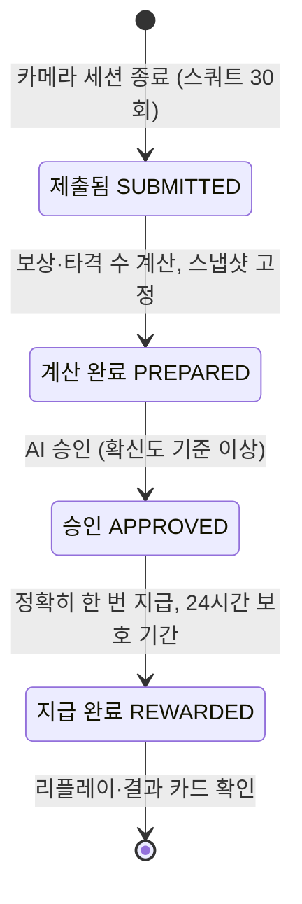

# 핵심 사용자 흐름

- 작성일: 2026-10-26
- 기준 문서: [03-rules-states-llm.md](../domain/03-rules-states-llm.md) 3-1·3-2·3-4, [제안서 draft.md](../proposal/draft.md) Ⅳ-10·Ⅳ-11·Ⅳ-12·Ⅳ-13, [mvp-assumptions-questions.md](../interview/mvp-assumptions-questions.md) 5-1·5-2, [client-meeting-1.md](../interview/client-meeting-1.md)

## 연결된 상태 전이

03-rules-states-llm.md의 핵심 대상: **운동 제출건 (WorkoutSubmission)**

지나가는 상태: `SUBMITTED` 제출됨 → `PREPARED` 계산 완료 → `APPROVED` 승인 (AI 판정) → `REWARDED` 지급 완료 (4개)

- 1차 미팅 결과(피드백 7·8, 질의응답 2)를 반영한 제안서 v2 Ⅳ-12의 **정상 경로**를 그대로 따른다. AI 판정 확신도가 기준 이상이면 사람 확인 없이 `PREPARED → APPROVED`로 간다.
- 03 3-2 표는 아직 미팅 전 기준(`PREPARED → PENDING_REVIEW → APPROVED`, 타 길드 검토)이다. 이 흐름과 맞도록 03 3-2를 제안서 Ⅳ-12처럼 고쳐야 한다 (제안서 Ⅳ-12 출처 메모에도 적혀 있음).
- 허용하지 않는 전이(판정 건너뛰기 `SUBMITTED → APPROVED`, 확신도 기준 미만 건의 `PREPARED → APPROVED`)는 이 흐름에서도 지킨다.

## 데모 시작 조건

흐름이 정상 경로로만 지나가도록 데모 전에 맞춰 둘 상태다. 하나라도 어긋나면 다른 경로(거부·상한 초과·사람 확인)로 빠진다.

| 조건 | 값 | 어긋나면 |
| --- | --- | --- |
| 플레이어 계정 | 가입·아바타·길드 가입이 끝난 14세 이상 계정 (F-01) | 가입 흐름부터 보여 줘야 함 (R16) |
| 오늘(KST) 스쿼트 인정량 | 0회 (일일 상한 200회까지 여유) | 30회 중 상한 초과분은 보상·타격 0 (R1) |
| 같은 시간대 활성 스쿼트 제출건 | 없음 | 접수 거부 (R3) |
| 운동 종류 | 스쿼트 1종 (첫 데모 범위, F-02) | 나머지 운동은 M2 |
| AI 판정 확신도 | 기준(90%) 이상이 나오는 촬영 위치·각도 | `PENDING_REVIEW`(지인·길드장 확인)로 넘어감 → 이 흐름에서 제외한 경로 |
| 공략 대상 | 던전 적 또는 주간 보스 중 하나를 미리 정함 (예: 골렘) | 리플레이에 보여 줄 적이 정해지지 않음 |

## 첫 데모에서 보여줄 흐름 (1개)

| 순서 | 누가 | 무엇을 하는가 | 이때 상태 | LLM 관여 |
| --- | --- | --- | --- | --- |
| 1 | 플레이어 | 운동 종류로 스쿼트를 고르고, 튜토리얼에서 판정 기준(가동범위)과 권장 촬영 각도를 확인한 뒤 목표 30회 × 1세트와 공략 대상을 정한다 (F-10, F-02) | (제출건 없음) | 없음 |
| 2 | 플레이어 / 기기 안 자세 인식 모델 | 카메라 앞에서 스쿼트 30회를 한다. 기기 안의 모델이 한 개씩 세며 렙마다 인정 여부를 바로 보여 준다. 가동범위 기준을 넘은 렙만 인정한다. 영상은 저장하지 않고 기기 밖으로 보내지 않는다 (F-11 즉시 피드백, R11·R12) | (제출건 없음) | 없음 (렙 판정은 온디바이스 자세 인식 모델과 판정 기준이 함) |
| 3 | 시스템 | 세션이 끝나면 얼굴 랜드마크를 뺀 관절 좌표와 렙 타임스탬프만 서버로 보낸다. 같은 시간대 활성 스쿼트 건이 없는지, 일일 상한이 남았는지 검사하고, 인정량 30회를 상한에서 원자적으로 예약한 뒤 제출건을 만든다 (F-02, R1·R2·R3) | `SUBMITTED` | 없음 |
| 4 | 규칙 엔진 + 시스템 | 경험치·총 피해량·타격 수(30회 ÷ 타격 단위 1회 = 30타)·드랍 1회·상한을 계산하고, 확정 능력치·약점 배율·카탈로그 버전을 스냅샷으로 고정한다. AI 판정 확신도를 첨부한다 (F-03, R5·R9) | `PREPARED` | **예.** 전투 서사(L3 `ai_story`)와 자세 교정 코멘트(L4 `ai_form_tip`)를 만든다. 수치는 넣지 않는다. LLM이 실패하면 기본 문구를 쓰고 상태 진행은 막지 않는다 |
| 5 | 플레이어 | 보상 미리보기 "충격파 스톰프 ×30"과 상자 개수를 확인한다 (F-03) | `PREPARED` | 없음 (숫자는 모두 규칙 엔진 결과) |
| 6 | 시스템 (AI 판정) | 스쿼트 판정 기준과 시작 시 무작위 동작 확인(실제 사람인지 확인, 신원은 식별하지 않음)을 통과하고 확신도가 기준 이상이므로 바로 승인한다 (F-04) | `APPROVED` | 없음 (승인 여부는 자세 인식 모델의 확신도와 판정 기준이 정하고, LLM 출력은 쓰지 않음) |
| 7 | 시스템 (트랜잭션) | 경험치·아이템·능력치 경험치·던전 공략 또는 보스 피해를 **정확히 한 번** 반영하고 24시간 보호 기간을 시작한다. 얻은 아이템은 `LOCKED`, 능력치 경험치는 '확정 대기'로 둔다. 같은 지급 요청이 다시 와도 기존 결과를 돌려준다 (F-05, R7) | `REWARDED` | 없음 |
| 8 | 플레이어 | 홈의 '전투 결과 도착' 카드를 눌러 캐릭터가 스쿼트 충격파로 30번 공격하는 리플레이(30 COMBO, 최대 30초, 스킵 가능)를 보고, 수치가 담긴 결과 카드와 서사, 다음 세션에서 고칠 점을 본다 (F-06, F-13) | `REWARDED` | **예.** 숫자·다른 스킬명·아이템명 검사를 통과한 L3 서사(2회 실패 시 기본 문구)와 진단·처방 표현 검사를 통과한 L4 코멘트를 보여 준다. 수치는 결과 카드에만 있다 |

## 단계별로 확인할 것

데모를 보면서 "제대로 됐다"를 판단하는 기준이다. 나중에 backlog.md 인수 조건과 테스트로 옮긴다.

| 순서 | 확인할 것 | 근거 |
| --- | --- | --- |
| 2 | 화면의 인정 렙 수와 기기 안 카운트가 같다. 사용자가 측정된 횟수를 늘릴 수 있는 버튼이 없다 (줄이기만 가능) | R12, F-02 |
| 3 | 서버로 간 데이터에 영상·얼굴 랜드마크가 없다. 제출건이 운동 종류 1개(스쿼트)만 담는다 | R2, R11 |
| 3 | 오늘 스쿼트 상한 예약량이 0 → 30이 된다 | R1 |
| 4 | 타격 수 30이 인정 렙 30과 같다. 스냅샷에 카탈로그 버전이 기록된다 | R5, R9 |
| 4 | LLM을 끈 상태로 돌려도 `PREPARED`까지 가고, 서사·코멘트 자리에 기본 문구가 나온다 | R5, 3-4 공통 원칙 |
| 6 | 확신도 값이 제출건에 남아 있고, 기준 이상일 때만 `APPROVED`가 된다 | 제안서 Ⅳ-12 |
| 7 | 지급 요청을 두 번 보내도 경험치·아이템·피해량이 한 번만 늘어난다 | 03 3-2 `APPROVED → REWARDED`, client-meeting-1 피드백 17 |
| 7 | 아이템이 `LOCKED`, 능력치 경험치가 '확정 대기'로 보이고, 위력·방어 계산에는 아직 들어가지 않는다 | R7 |
| 8 | 리플레이 콤보 수 30이 결과 카드의 타격 수와 같다. 서사에 숫자·다른 스킬명·아이템명이 없다 | R9, R10 |

## 이 흐름에서 LLM에 보내지 않는 정보

| LLM | 보내는 것 | 보내지 않는 것 |
| --- | --- | --- |
| L3 전투 서사 | 카탈로그 스킬명(충격파 스톰프), 운동 종류, 적·보스 이름, 약점 적중 여부 | 수치, 메모, 관절 좌표, 닉네임 |
| L4 자세 교정 코멘트 | 운동 종류와 판정 기준, 렙별 관절 각도 요약 통계, 미인정 사유 | 관절 좌표 원본, 얼굴 정보, 닉네임·길드명 |

L1 기록 요약·L2 이상치 설명은 사람 확인(`PENDING_REVIEW`) 화면에 보여 주는 것이라 이 흐름에는 나오지 않는다.

## 이 흐름에 포함하지 않은 경로

- 취소는 backlog.md의 필수 스토리 US-__에서 다룬다: `SUBMITTED` / `PREPARED` / `PENDING_REVIEW` → `CANCELED` (승인 전 신청자 취소, 상한 예약 해제, 취소와 승인이 동시에 오면 먼저 성공한 한 건만 인정)
- 반려는 backlog.md의 필수 스토리 US-__에서 다룬다: `PENDING_REVIEW` → `REJECTED` → `CLOSED` (확인자가 사유 코드 `기록이상` / `본인확인실패` / `도용의심`과 설명을 남기고 반려. 카메라 세션은 재제출할 수 없어 `CLOSED`, 상한 예약 해제)
- 애매한 건의 사람 확인: 확신도가 기준 미만이면 `PREPARED` → `PENDING_REVIEW` (신청자가 보낼 내용을 미리 보고 지인·길드장에게 보냄) → `APPROVED` / `REJECTED`. 제안서에서 첫 데모 제외로 정함
- 재제출 `REJECTED` → `SUBMITTED`: 연동 러닝 세션만 해당하고 러닝 연동이 후순위라 MVP에서는 없음 (제안서 Ⅳ-11 F-02)
- 신고·회수 `REWARDED` → `REVOKED`: F-07 선택 기능
- 접수 단계의 실패: 같은 시간대 활성 스쿼트 건이 있으면 접수 거부(R3), 일일 상한을 넘은 인정량은 기록만 남기고 보상·타격 0, 리플레이 없이 "일일 상한 초과" 카드(R1·R9)
- 시스템 실패: 계산 실패 시 `SUBMITTED` 유지 후 재시도, 지급 실패 시 `APPROVED` 유지 후 지급만 재시도 (03 3-2)
- 첫 데모에서 뺀 기능: 휴식 경고·경고 3회 공격 실패(F-11 일부), 운동 중 모드, 오각형 성장 리포트(F-12), 나머지 운동·약점 배율, 걸음 수 체력 회복(F-09), 러닝 연동, 음성 인식(F-14), 숙련도 이펙트·보상 상자 연출 (제안서 Ⅰ-3 '이번에 하지 않는 것')

## 미확정

| 내용 | 왜 정해야 하나 | 언제 |
| --- | --- | --- |
| AI 판정 확신도 기준 90% 확정 | 실제 모델 확신도가 대부분 90% 아래면 데모가 정상 경로로 가지 않음 (client-meeting-1 '여전히 가정' 2행) | 1주차 자세 인식 모델 테스트 후 |
| AI 자동 승인 건에도 L1·L2를 만들지 | 제안서 F-03은 `PREPARED`에서 L1~L4를 모두 만든다고 했지만, 자동 승인 건에서는 보는 사람이 없어 호출 비용만 듦 | 다음 팀 회의 |
| 촬영 각도 | 각도가 맞지 않으면 정상 렙이 미인정되거나 확신도가 낮아짐 | 1주차 카메라 각도 테스트 후 |
| 데모에서 공략 대상을 던전 적으로 할지 주간 보스로 할지 | 7·8단계에서 보여 줄 반영 결과(던전 공략 / 보스 체력)가 달라짐 | 다음 팀 회의 |
| 03 3-2를 제안서 Ⅳ-12 기준으로 고치기 | 지금은 이 문서와 03 3-2의 상태 흐름이 다름 | 03 정리 담당 |
